<div align="center">

<br />

<h1>alongio<span style="color:#E88C9F">.</span></h1>

<p><strong>A playful personal &amp; couple lifestyle companion — designed &amp; engineered from first principles.</strong></p>

<p>
  Organize daily plans, preserve shared memories, and cook together inside a warm,<br />
  <em>Romantic Playful Geometric Abstract</em> mobile experience built with React Native, Reanimated, and custom 60fps Lottie mascots.
</p>

<p>
  
  
  
  
  
  
</p>

<p>
  <a href="#-product-showcase">Product Showcase</a> •
  <a href="#-core-modules">Core Modules</a> •
  <a href="#-design-system">Design System</a> •
  <a href="#-motion--custom-lottie-mascots">Motion &amp; Lottie</a> •
  <a href="#-tech-stack--architecture">Architecture</a> •
  <a href="#-contributing--branching-workflow">Contributing</a> •
  <a href="#-roadmap">Roadmap</a>
</p>

<br />

<table>
  <tr>
    <td align="center" width="20%">
      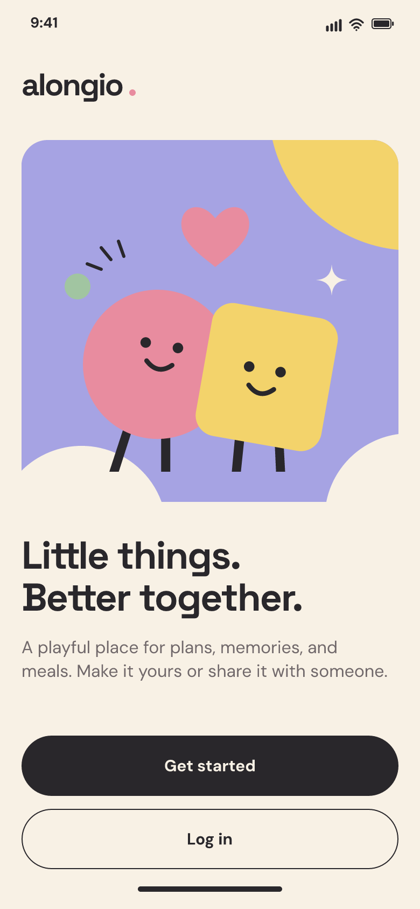
      <br /><sub><strong>Welcome</strong></sub>
    </td>
    <td align="center" width="20%">
      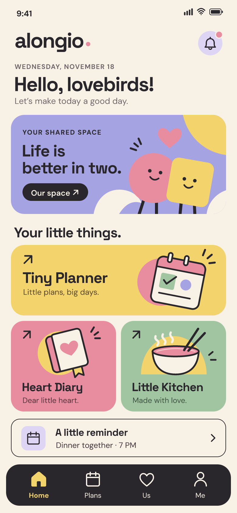
      <br /><sub><strong>Home · Couple Mode</strong></sub>
    </td>
    <td align="center" width="20%">
      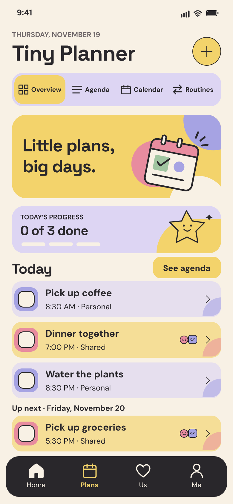
      <br /><sub><strong>Tiny Planner</strong></sub>
    </td>
    <td align="center" width="20%">
      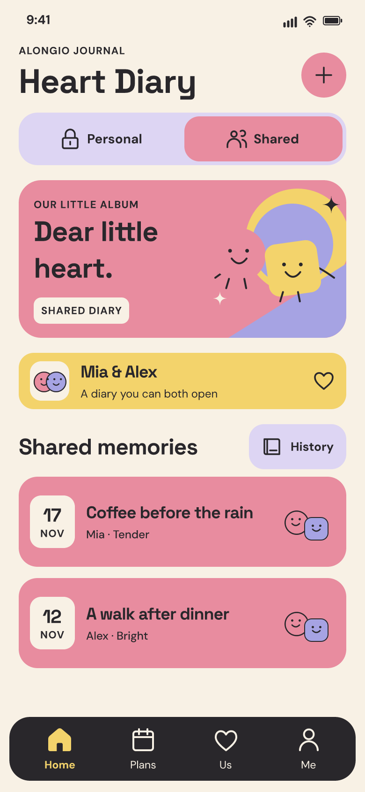
      <br /><sub><strong>Heart Diary</strong></sub>
    </td>
    <td align="center" width="20%">
      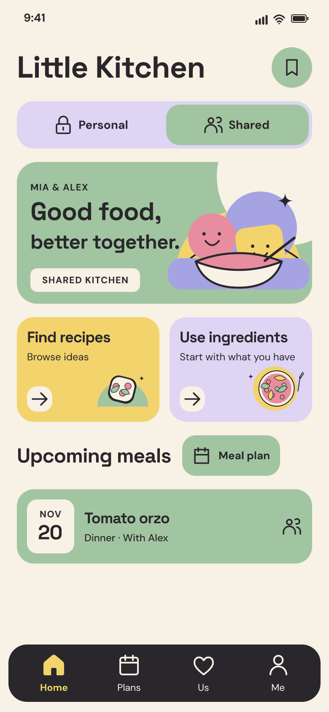
      <br /><sub><strong>Little Kitchen</strong></sub>
    </td>
  </tr>
</table>

</div>

---

## ✨ Why Alongio?

Most productivity apps feel like cold corporate spreadsheets. **Alongio** reimagines everyday personal and couple organization as a warm, character-driven companion—balancing thoughtful UX engineering with joyful visual craft.

- **Two Seamless Modes**: Switch effortlessly between **Personal Mode** (private plans, private diary entries, solo meals) and **Couple Mode** (shared routines, collaborative memories, meal plans for two)—with privacy respected by default.
- **Crafted End-to-End**: Every token, component, illustration, Lottie animation, toast state, and responsive breakpoint (`320px → 440px`) is authored in one cohesive system ([`design/Alongio.figcraft`](design/Alongio.figcraft) — **11 pages**, **404 reusable components**) before translating cleanly into React Native.
- **Built for Tactile Delight**: Combines **UI-thread Reanimated 4 physics** with **11 custom 60fps one-shot Lottie cartoon assets**, all backed by `useReducedMotion()` accessibility fallbacks.

---

## 🧩 Core Modules

### 1. Tiny Planner — *Little plans, big days.*
> **Accent:** Butter Yellow (`#F3D36B`) · **Focus:** Daily clarity, recurring habits, and **Together Growth**

Organize solo or shared tasks, switch smoothly between Overview, Daily Agenda, Calendar, and Routines, check in together on shared habits, and grow your couple level month by month—without guilt or competitive rankings.

<table>
  <tr>
    <td align="center" width="25%">
      
      <br /><sub>Overview &amp; Today's Progress</sub>
    </td>
    <td align="center" width="25%">
      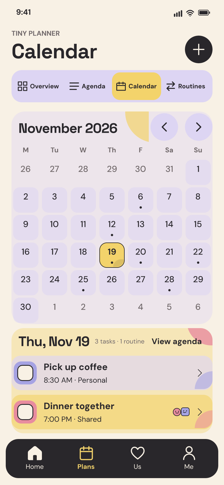
      <br /><sub>Calendar View</sub>
    </td>
    <td align="center" width="25%">
      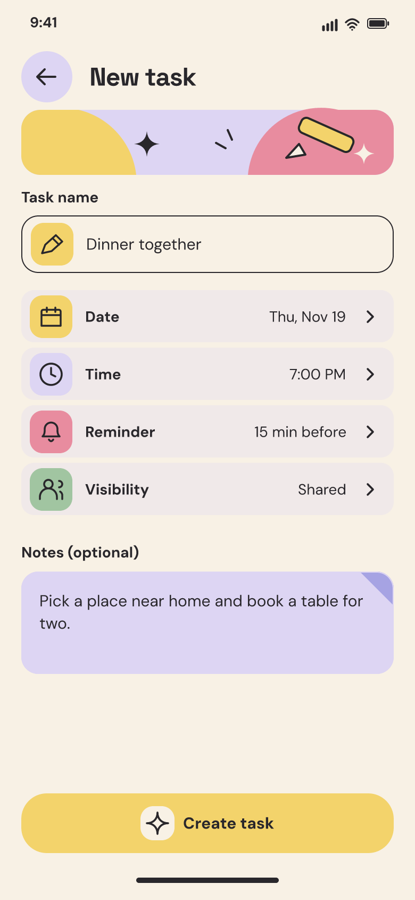
      <br /><sub>Create Personal / Shared Task</sub>
    </td>
    <td align="center" width="25%">
      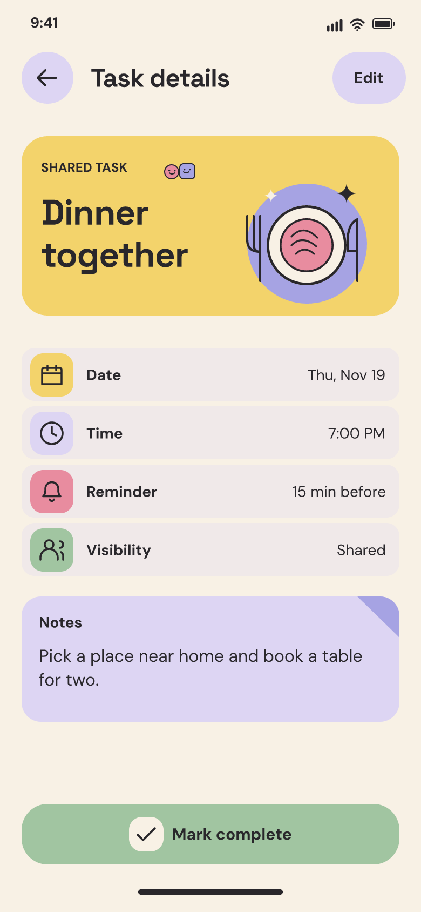
      <br /><sub>Task Details &amp; Ownership</sub>
    </td>
  </tr>
</table>

---

### 2. Heart Diary — *Dear little heart.*
> **Accent:** Romantic Pink (`#E88C9F`) · **Focus:** Intimate digital scrapbook, moods, and shared memories

A warm editorial journaling space where entries remain private by default until explicitly shared with a partner—complete with expressive geometric mood stamps, photo memories, and cozy reading views.

<table>
  <tr>
    <td align="center" width="25%">
      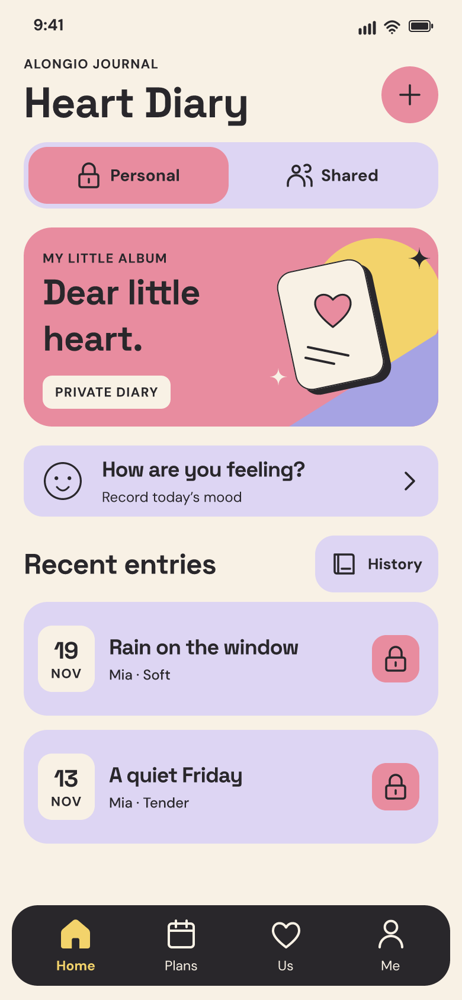
      <br /><sub>Personal Diary Space</sub>
    </td>
    <td align="center" width="25%">
      
      <br /><sub>Shared Couple Album</sub>
    </td>
    <td align="center" width="25%">
      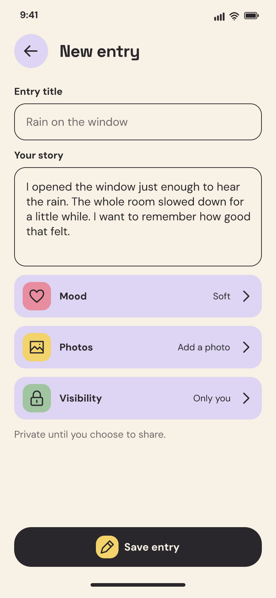
      <br /><sub>Editorial Writing Composer</sub>
    </td>
    <td align="center" width="25%">
      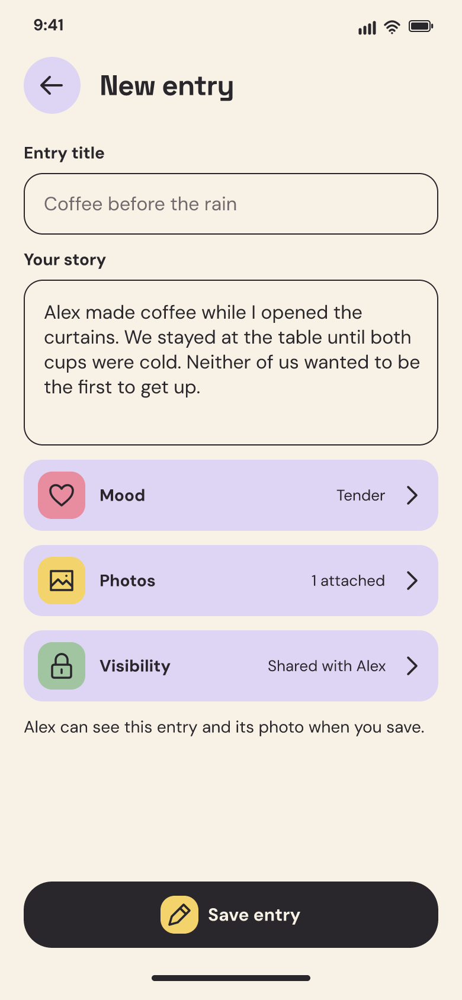
      <br /><sub>Explicit Sharing Choice</sub>
    </td>
  </tr>
</table>

---

### 3. Little Kitchen — *Made with love.*
> **Accent:** Matcha Green (`#A1C5A1`) · **Focus:** Illustrated cookbook, **Kitchen Magic** AI assistant, and meal planning

Discover cozy recipes, describe or photograph ingredients in your fridge using **Kitchen Magic** (multimodal AI recipe generation), save favorites, and schedule meals together.

<table>
  <tr>
    <td align="center" width="25%">
      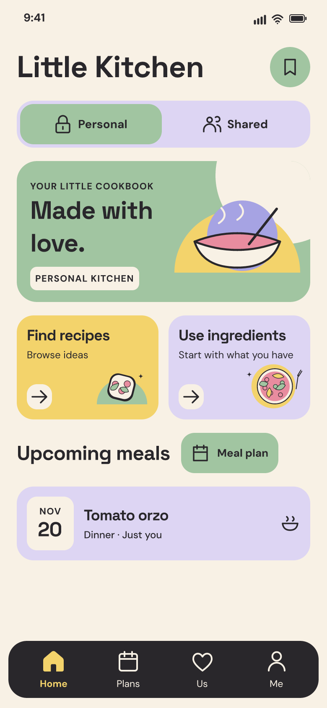
      <br /><sub>Personal Kitchen</sub>
    </td>
    <td align="center" width="25%">
      
      <br /><sub>Shared Kitchen for Two</sub>
    </td>
    <td align="center" width="25%">
      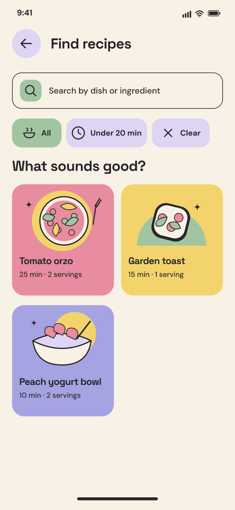
      <br /><sub>Recipe Discovery</sub>
    </td>
    <td align="center" width="25%">
      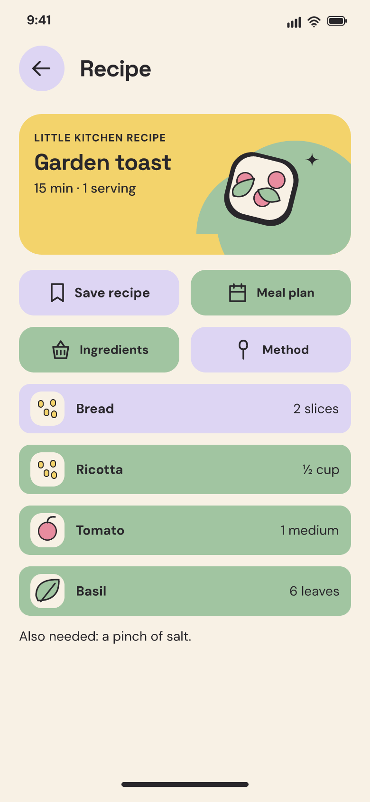
      <br /><sub>Illustrated Recipe View</sub>
    </td>
  </tr>
</table>

---

## 📱 Product Showcase

Beyond the three core modules, Alongio covers the complete lifecycle—from expressive onboarding and OTP verification to partner pairing, account controls, and a calm notification inbox.

<table>
  <tr>
    <td align="center" width="25%">
      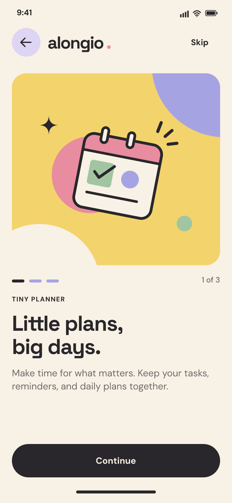
      <br /><sub><strong>Onboarding &amp; Auth</strong><br />OTP, Reset Password &amp; Mode Setup</sub>
    </td>
    <td align="center" width="25%">
      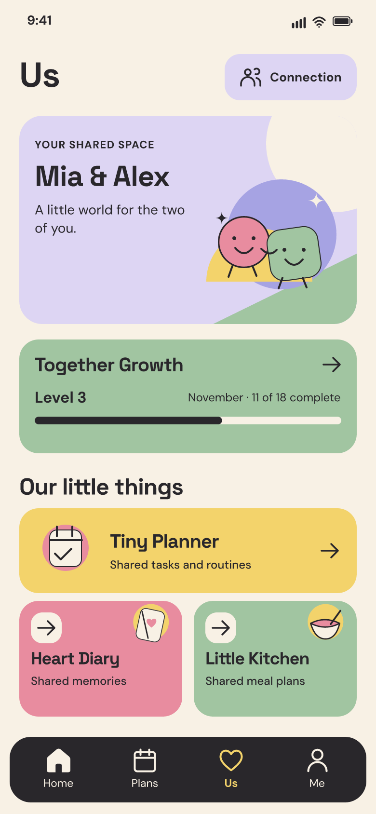
      <br /><sub><strong>Couple Space</strong><br />Invite Codes &amp; Shared Growth</sub>
    </td>
    <td align="center" width="25%">
      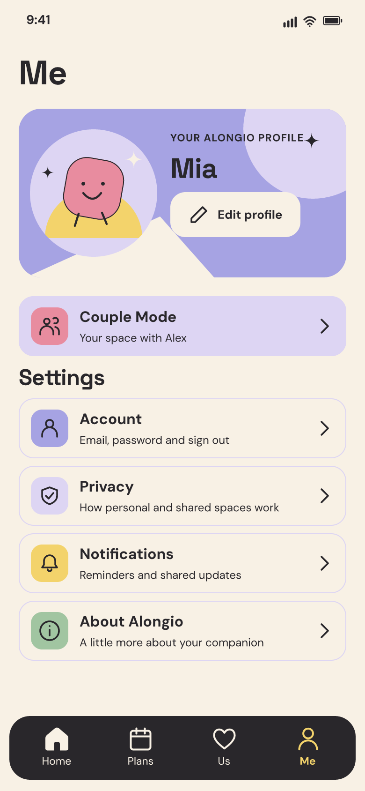
      <br /><sub><strong>Profile &amp; Settings</strong><br />Mode Switch, Privacy &amp; Security</sub>
    </td>
    <td align="center" width="25%">
      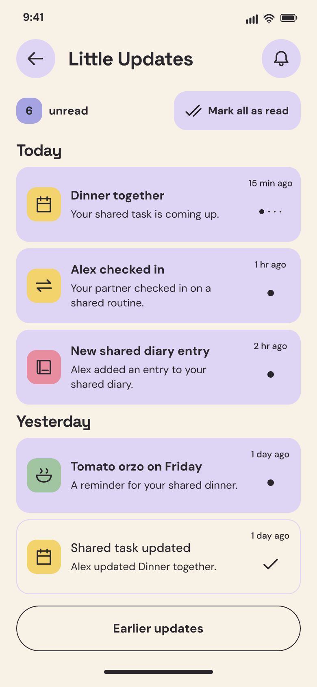
      <br /><sub><strong>Little Updates</strong><br />Calm Shared Activity Inbox</sub>
    </td>
  </tr>
</table>

---

## 🎨 Design System

Alongio's visual direction is **Romantic Playful Geometric Abstract**—soft Bauhaus shapes, flat high-contrast color blocks, zero clutter, and expressive character storytelling.

### Color Palette (`Alongio / Palette`)

<p align="center">
  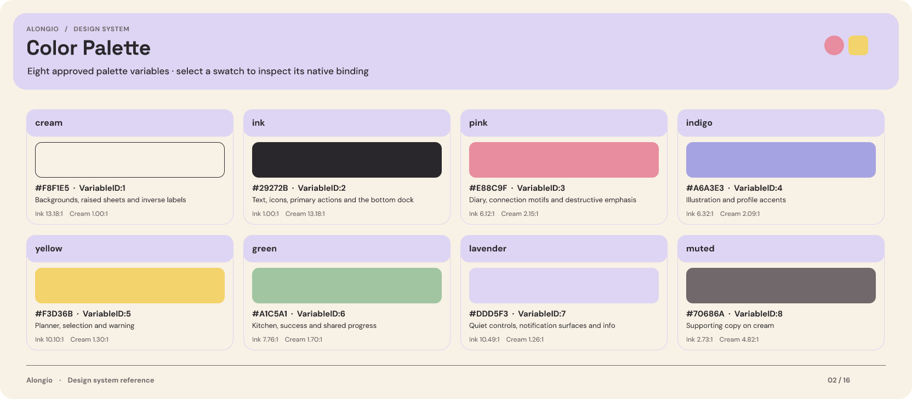
</p>

| Token | HEX | Role |
| :--- | :--- | :--- |
| `cream` | `#F8F1E5` | Warm canvas foundation, raised sheets, inverse labels |
| `ink` | `#29272B` | Primary typography, `2px` illustration strokes, primary buttons, bottom dock |
| `pink` | `#E88C9F` | Heart Diary accent, couple connection motifs, error surfaces |
| `indigo` | `#A6A3E3` | Shared space hero, profile accents, decorative contrast |
| `yellow` | `#F3D36B` | Tiny Planner accent, active tab pill, warning surfaces |
| `green` | `#A1C5A1` | Little Kitchen accent, success states, Together Growth progress |
| `lavender` | `#DDD5F3` | Quiet interactive surfaces, secondary cards, informational toasts |
| `muted` | `#70686A` | Supporting copy and subtle captions on cream |

- **Typography**: `Space Grotesk` (editorial geometric headings) paired with `DM Sans` (clean, legible UI & body copy).
- **Responsive Engineering**: Validated across **7 logical mobile viewports** from compact `320 × 568` to large `440 × 956` using native Auto Layout, safe areas, and `≥ 48 × 48` minimum touch targets.

### Cross-Flow Feedback, Toasts & System States

Every user journey ships with consistent, accessible feedback—**Success**, **Error**, **Warning**, and **Information** floating toasts plus **Message**, **Undo**, and **Retry** snackbars placed cleanly across all 8 flow pages.

<p align="center">
  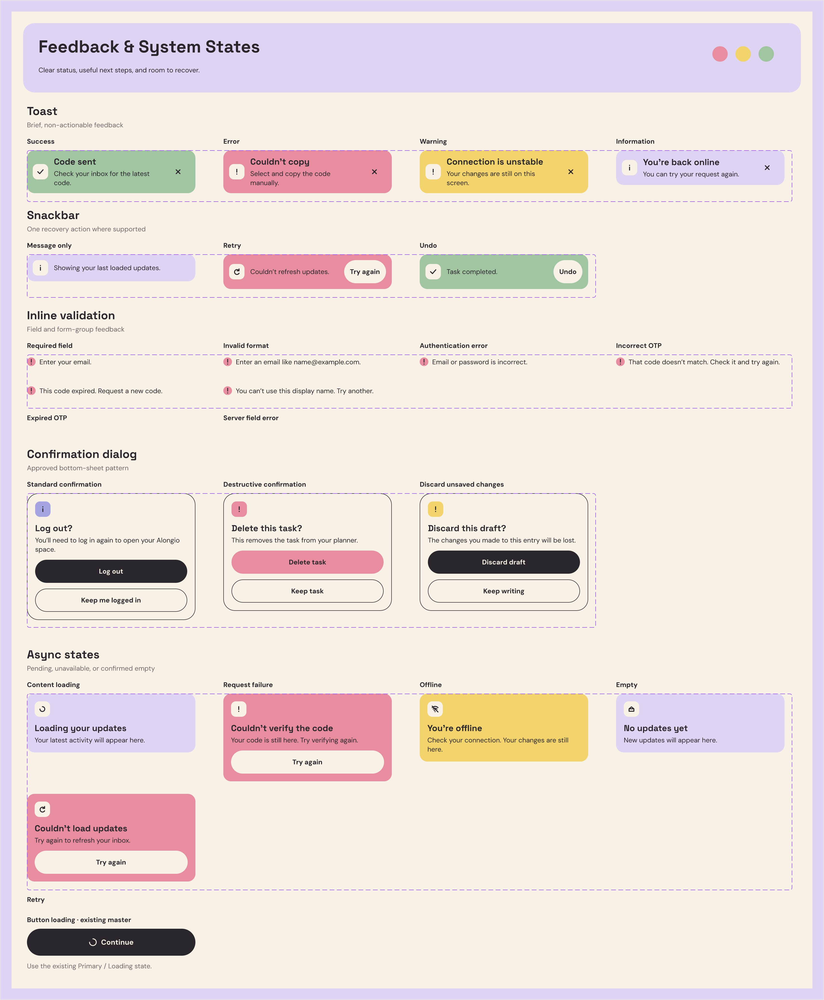
</p>

<details>
<summary><strong>📸 View Toast &amp; Snackbar Placements Across All 8 App Flows (Click to expand)</strong></summary>
<br />

- **Home** (`Welcome back!`, `Your space is ready`, `Connection is unstable`)
  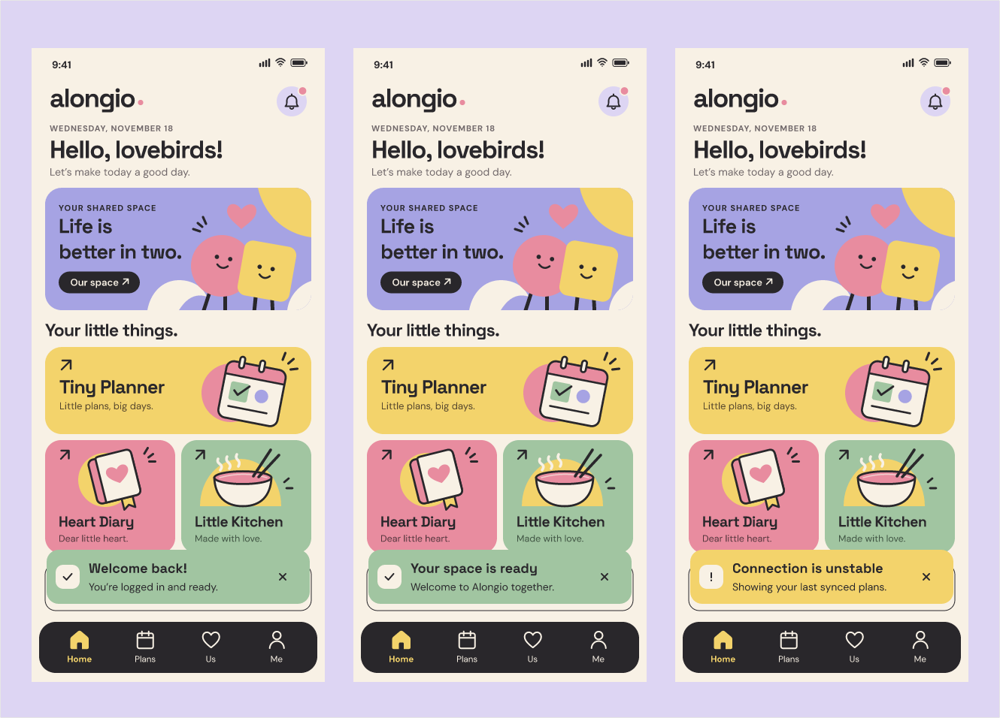
- **Tiny Planner** (`Task added`, `Task completed · Undo`, `Routine updated`, `Couldn't save · Retry`)
  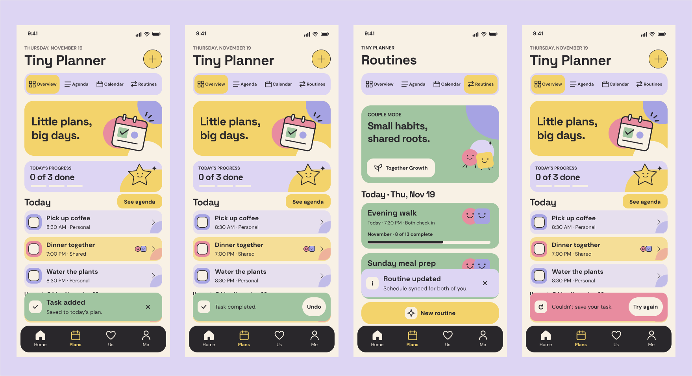
- **Heart Diary** (`Entry saved`, `Shared with partner`, `Entry removed · Undo`, `Photo upload failed · Retry`)
  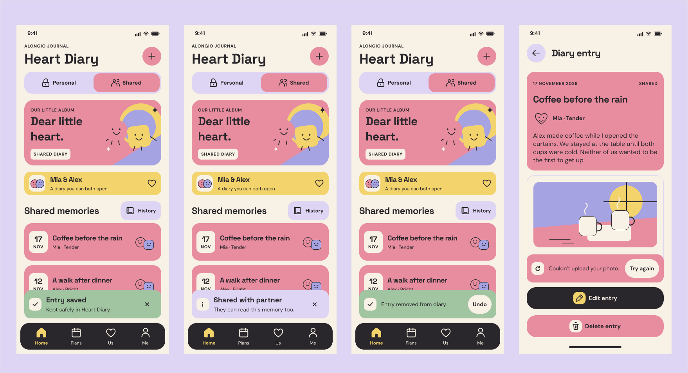
- **Little Kitchen** (`Recipe saved`, `Added to meal plan`, `Removed from meal plan · Undo`, `Generation failed · Retry`)
  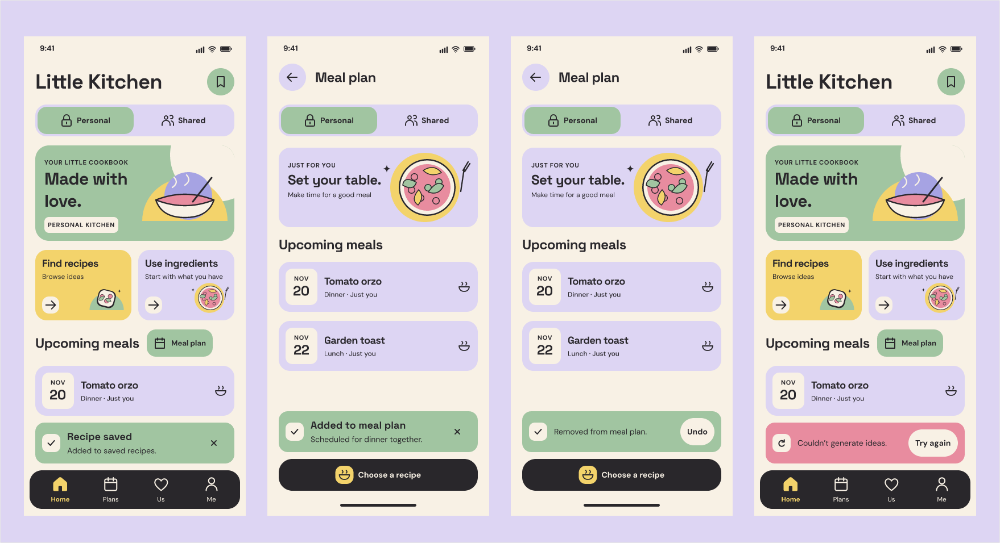
- **Couple Space** (`Invite code copied`, `You're connected!`, `Invitation canceled`, `Couldn't connect`)
  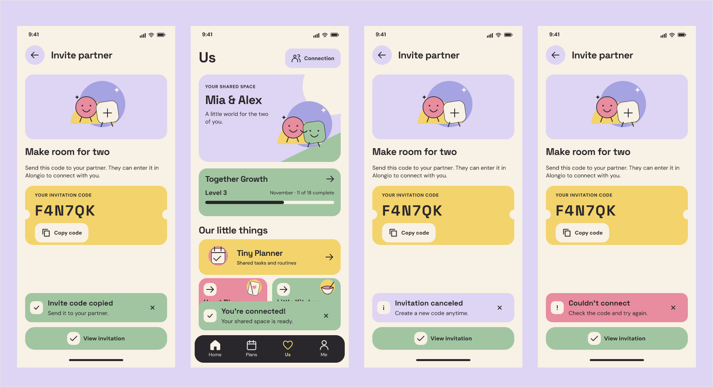
- **Profile &amp; Settings** (`Profile updated`, `Password updated`, `Couple Mode active`, `Couldn't save · Retry`)
  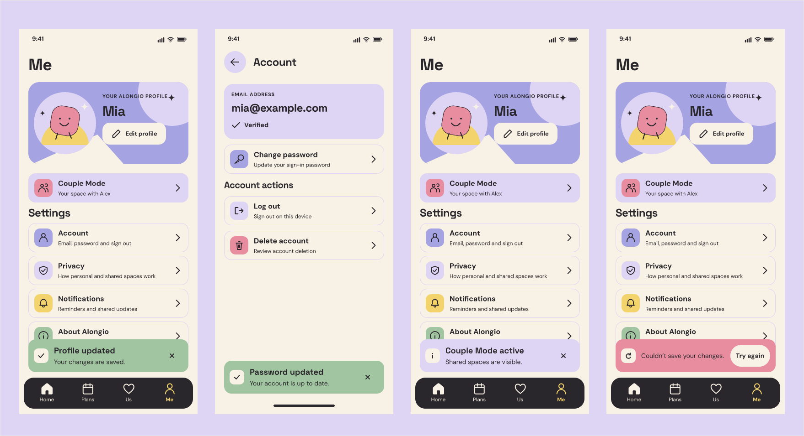
- **Little Updates** (`All caught up`, `Offline cache`, `Couldn't refresh · Retry`)
  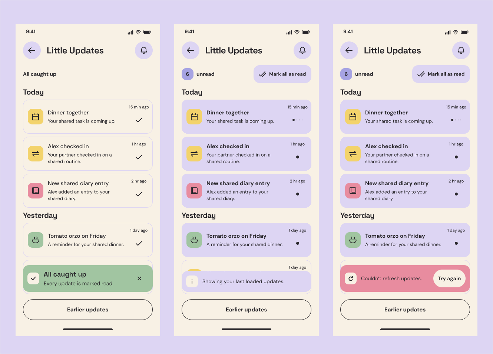
- **Authentication &amp; Password Recovery** (`Password updated`, `Session ended`, `Email in use`, `Reset link sent`, `OTP states`)
  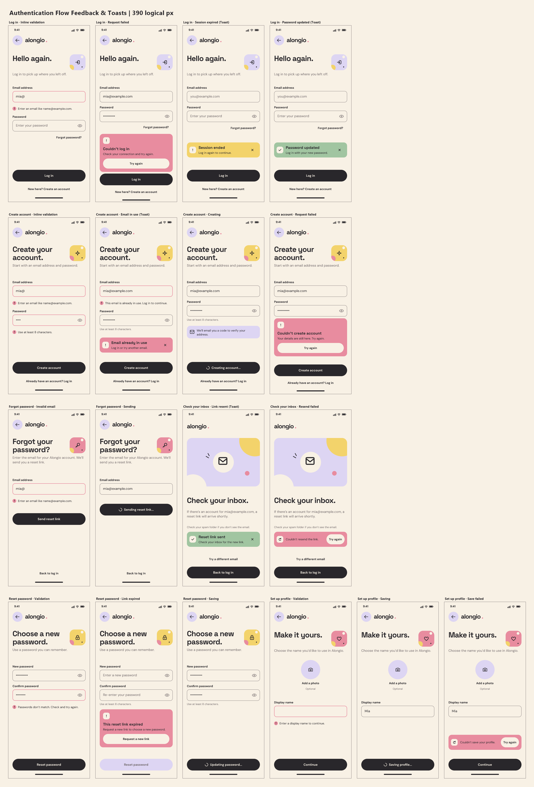

</details>

---

## 🎬 Motion & Custom Lottie Mascots

Alongio separates motion into **two clean layers** ([`design/MOTION.md`](design/MOTION.md)) so storytelling feels rich while core interactions stay razor-fast:

1. **Functional UI Motion (React Native Reanimated 4)**: UI-thread worklets for button press (`90ms`), state changes (`180ms`), smooth sliding yellow tab pills (`mass: 1, stiffness: 260, damping: 30`), Gorhom bottom sheets (`240ms`), and keyboard-aware layouts.
2. **2D Cartoon Storytelling (11 Custom Lottie Assets)**: Flat top-level vector layers (`0` precomp alpha mattes, 3D transforms, explicit keyframe end-values, `60 fps`, **one-shot with tap-to-replay**) engineered specifically for native `lottie-android` and `lottie-ios` under React Native Fabric, with automatic static fallbacks when Reduce Motion is enabled.

<table>
  <tr>
    <td align="center" width="50%">
      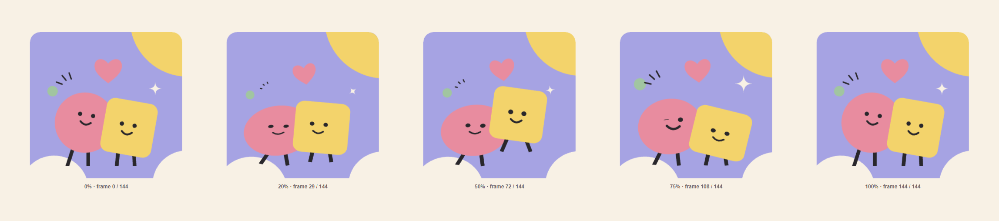
      <br /><sub><code>auth-welcome-mascots.json</code> · 40.6 KB · 60fps One-Shot</sub>
    </td>
    <td align="center" width="50%">
      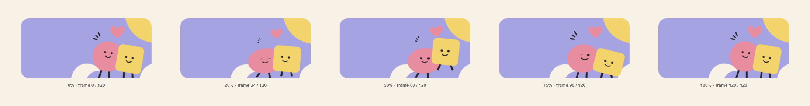
      <br /><sub><code>home-shared-space-mascots.json</code> · 34.6 KB · 60fps One-Shot</sub>
    </td>
  </tr>
  <tr>
    <td align="center" width="50%">
      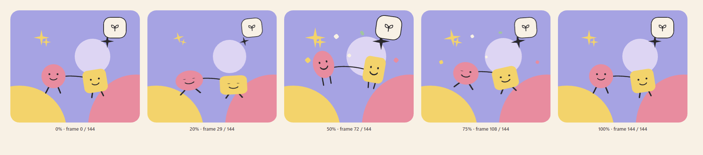
      <br /><sub><code>planner-levelup-celebration.json</code> · 43.7 KB · Together Growth</sub>
    </td>
    <td align="center" width="50%">
      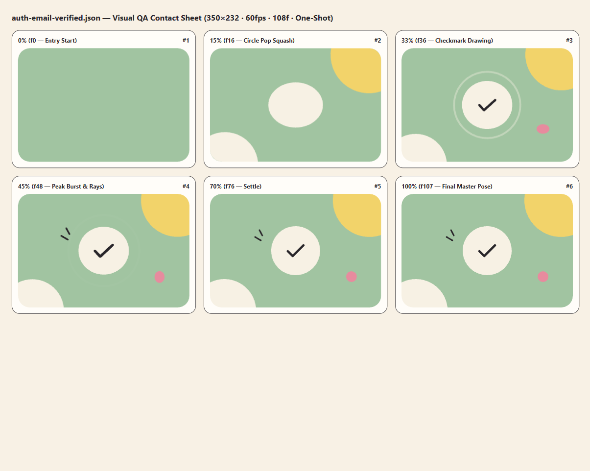
      <br /><sub><code>auth-email-verified.json</code> · 11.7 KB · TrimPath Checkmark Pop</sub>
    </td>
  </tr>
</table>

<details>
<summary><strong>🎞️ Full Lottie Asset Inventory (11 Native-Ready Files in <code>assets/animations/</code>)</strong></summary>

| Asset | Module | Canvas | Motion Story |
| :--- | :--- | :---: | :--- |
| [`auth-splash-mascots.json`](assets/animations/auth-splash-mascots.json) | Auth · Splash | `350×350` | Paired mascot geometric entrance & warm settle |
| [`auth-welcome-mascots.json`](assets/animations/auth-welcome-mascots.json) | Auth · Greeting | `350×322` | Squash anticipation, staggered jumps, wink & heart pop |
| [`auth-onboarding-planner.json`](assets/animations/auth-onboarding-planner.json) | Onboarding · 1 | `350×322` | Calendar bounce & checkmark celebration boom |
| [`auth-onboarding-diary.json`](assets/animations/auth-onboarding-diary.json) | Onboarding · 2 | `350×322` | Diary soar, ribbon sway & floating heart pop |
| [`auth-onboarding-kitchen.json`](assets/animations/auth-onboarding-kitchen.json) | Onboarding · 3 | `350×322` | Cozy pot simmer, chopstick stir & rising steam |
| [`auth-email-verified.json`](assets/animations/auth-email-verified.json) | Auth · Verified | `350×232` | Circle spring pop, checkmark draw-in & ink ray burst |
| [`auth-reset-inbox.json`](assets/animations/auth-reset-inbox.json) | Auth · Reset | `350×232` | Airmail swoop-in, landing squash & flap seal draw |
| [`home-shared-space-mascots.json`](assets/animations/home-shared-space-mascots.json) | Home · Hero | `354×163` | Paired couple lean-in, heart bloom & sparkle settle |
| [`planner-progress-star.json`](assets/animations/planner-progress-star.json) | Tiny Planner | `120×79` | Star spin-pop & celebratory sparkles on progress |
| [`planner-empty-mascots.json`](assets/animations/planner-empty-mascots.json) | Tiny Planner | `350×286` | Friendly empty-state mascot wave & gentle bob |
| [`planner-levelup-celebration.json`](assets/animations/planner-levelup-celebration.json) | Together Growth | `350×304` | Paired couple high-five jump & milestone burst |

</details>

---

## 🛠️ Tech Stack & Architecture

| Layer | Technology |
| :--- | :--- |
| **Framework** | React Native `0.88.1` (New Architecture / Fabric) · Expo `~58.0.26` · React `19.3` · TypeScript `6.0` |
| **Motion & Gestures** | `react-native-reanimated 4.7` · `react-native-gesture-handler 3.3` · `lottie-react-native 7.5` · `@gorhom/bottom-sheet 5` |
| **Navigation** | `@react-navigation/native 7` · `@react-navigation/native-stack 7` |
| **Backend & Data** | `@react-native-firebase/auth` · `@react-native-firebase/firestore` · `@react-native-firebase/storage` |
| **Forms & Media** | `react-hook-form 7` · `expo-image` · `expo-image-picker` · `expo-haptics` · `react-native-svg` · `date-fns 4` |
| **Design & Prototyping** | FigCraft (`design/Alongio.figcraft`) · Tokenized Design System (`design/system/tokens.json`) |

### Project Structure

```text
alongio-v1/
├── assets/
│   └── animations/          # 11 native-ready 60fps Lottie JSON mascot & confirmation assets
├── design/
│   ├── Alongio.figcraft     # Master editable design file (11 pages · 404 components)
│   ├── DESIGN.md            # Brand identity, module guidelines & responsive standards
│   ├── TOKENS.md            # Canonical palette, typography, spacing & geometry tokens
│   ├── MOTION.md            # Two-layer Soft Playful Motion architecture & physics tokens
│   ├── animations/previews/ # Playwright-verified multi-frame Lottie QA contact sheets
│   └── screens/             # Exported UI, Design System, Feedback & Motion previews
├── docs/
│   ├── product.md           # Product vision & user modes
│   └── mvp.md               # Complete MVP 1 functional specification
└── src/
    ├── assets/              # Bundled fonts, images & runtime animation assets
    ├── components/          # Shared primitives (MascotAnimation, Button, UIOTPInput) & custom UI
    ├── interfaces/          # Shared TypeScript contracts
    ├── pages/               # Feature screens (auth, home, planner, diary, kitchen, ...)
    ├── routes/              # React Navigation stacks & tab routing
    ├── stores/              # App & user state management
    ├── styles/              # Brand color palette & typography tokens
    └── utils/               # Navigation helpers & utilities
```

---

## 🚀 Getting Started

```bash
# 1. Clone the repository
git clone https://github.com/TioNovriadiPutra/alongio.git
cd alongio

# 2. Install dependencies
npm install

# 3. Start the Expo development server
npx expo start
```

> **Note:** Native Firebase modules (`@react-native-firebase/*`) and `lottie-react-native` require an Expo Development Build (`npx expo run:android` or `npx expo run:ios`) with your own `google-services.json` / `GoogleService-Info.plist`.

---

## 🤝 Contributing & Branching Workflow

Contributions are welcome! Direct pushes to `main` and `dev` are restricted—all changes must follow our **clean feature + `-dev` integration branch** workflow so feature branches stay isolated from unreleased `dev` commits.

```text
main ──▶ feature/new ──▶ feature/new-dev (+ pull origin dev) ──▶ PR into dev
```

### Step-by-Step Contribution Flow

1. **Create a feature branch from `main`**
   Always branch off the latest `main` (e.g. `feature/<name>` or `fix/<name>`):
   ```bash
   git checkout main
   git pull origin main
   git checkout -b feature/new
   ```
2. **Build & commit on your feature branch**
   Keep all your commits cleanly on `feature/new` without pulling `dev` directly into it.
3. **Create a `-dev` integration branch from your feature branch**
   When you're ready to integrate into `dev`, branch off your feature branch and append `-dev` to its name (`feature/new` → `feature/new-dev`):
   ```bash
   git checkout -b feature/new-dev
   ```
4. **Pull latest `dev` into the `-dev` branch & resolve conflicts**
   ```bash
   git pull origin dev
   # resolve any merge conflicts locally, then commit if needed
   git push -u origin feature/new-dev
   ```
5. **Open a Pull Request into `dev`**
   - Target branch: **`dev`** (from `feature/new-dev`).
   - Keep `feature/new` clean and untouched so it can be cleanly promoted to `main` once verified.

---

## 🗺️ Roadmap

- [x] Brand identity, token registry & 404-component FigCraft Design System
- [x] Complete MVP UI flows across all 8 app domains (responsive `320px → 440px`)
- [x] Cross-flow Feedback, Toast & Snackbar system across all 8 pages
- [x] Custom 60fps Lottie mascots & motion specs for **Auth**, **Home**, and **Tiny Planner**
- [ ] **In Progress**: React Native implementation of Authentication, Onboarding & Password Recovery
- [ ] Motion & Lottie storytelling packs for **Heart Diary** and **Little Kitchen**
- [ ] Full implementation of **Tiny Planner**, **Heart Diary**, **Little Kitchen** & **Couple Space**

---

<div align="center">

### Crafted with care by **Tio Novriadi Putra**

Designing and building warm, human-centered mobile experiences end-to-end.

<p>
  <a href="https://github.com/TioNovriadiPutra">
    
  </a>
  <!-- Replace the # links below with your LinkedIn, X/Twitter, or Portfolio URLs -->
  <a href="#">
    
  </a>
  <a href="#">
    
  </a>
</p>

<sub><em>Life is better in two.</em> 💛🌸💚</sub>

</div>
