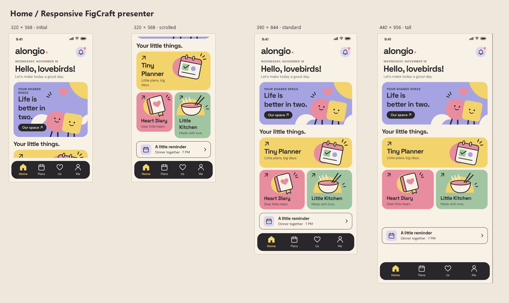
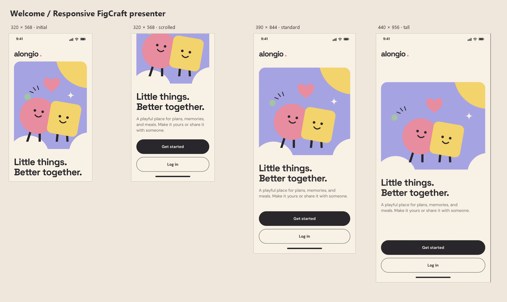

# Alongio responsive design audit

## Phase 9 — Final regression

See the [final regression audit](final-regression-audit.md) for the full-master viewport matrix, saved-master preservation evidence and remaining issues. The module-level tables below preserve the results of the earlier approval reviews.

## Phase 8 — Little Updates

**Scope and result.** The editable FigCraft master contains 20 Little Updates frames in four original sections, with nine named review starts. All 20 were corrected, saved, reopened and verified locked. Authentication, Home, Tiny Planner, Heart Diary, Little Kitchen, Couple Space and Profile & Settings account for the other **288** approved frames. Their native page trees, locks, prototype bindings, styles and variables match the pre-edit snapshot. All **128** existing Little Updates bindings, including those behind the two simulated sheets and the loading timer, were preserved.

### Root causes and changes

| Scope | Baseline issue | Correction |
| --- | --- | --- |
| Inbox and history, including read states | Fixed 350 px cards and main content with no independent scroll range. Lower notifications or history actions left the short viewport. | Full-width cards and a scrollable chronology between the fixed header/toolbar and history actions. The existing Back, Preferences and Mark all as read stay available. |
| Empty, loading, retry, device and recovery states | Supporting guidance and actions shared fixed screen coordinates. | A flexible scroll region, bottom-anchored actions and a fixed status/header area. The responsive artwork panel centers the original 180 × 136 vector composition and reanchors edge decoration. |
| Single notification and permission sheets | The overlays stayed at their original baseline position and their lower controls could leave the viewport. | Bottom-anchored sheets with fixed dismissal and actions, a separate scrollable description, and a viewport-sized dimmed underlay. |
| Notification cards | Title and copy relied on baseline widths. | Twelve Little Updates category/state component variants plus a local skeleton preserve style and add width-driven wrapping and height growth. The timestamp and read-status rail stays separate. |

This stack uses the same native layout pattern as the approved responsive groups. Little Updates retains its Back and Preferences header and does not gain an app tab bar. The perimeter uses the authored 16 px home-indicator clearance. On the shortest fixture, scroll the illustration or guidance above the fixed buttons to read overflow. The art panel adapts horizontally and the central art keeps its approved natural dimensions. FigCraft’s constrain-proportions flag did not bind a fill-width child’s height to its width in the native Auto Layout probe, so the fitted artwork is preserved without viewport-dependent scaling.

### Viewport sweep

Before counts come from the original responsive audit’s action losses. After counts require each foreground tap target to be fully reachable through viewport scrolling. The 107 active taps per viewport exclude the loading timer and occluded underlay actions. The responsive presenter verified actual tap geometry and fixed control stability, and all 140 cases also received direct native geometry inspection.

| Logical viewport | Affected frames before | Frames checked | Foreground taps reached | Affected frames after |
| --- | ---: | ---: | ---: | ---: |
| 320 × 568 | 20 | 20 | 107 | 0 |
| 360 × 640 | 19 | 20 | 107 | 0 |
| 375 × 667 | 19 | 20 | 107 | 0 |
| 390 × 844 | 0 | 20 | 107 | 0 |
| 402 × 874 | 0 | 20 | 107 | 0 |
| 430 × 932 | 0 | 20 | 107 | 0 |
| 440 × 956 | 0 | 20 | 107 | 0 |

Baseline QA compared each of the 20 native 390 × 844 corrected exports against its approved archived PNG and the pre-edit native render. The first pass uncovered a 2 px per-card increase from the border in hug-height calculation. The correction restored the intended positions and 92 px baseline card height. At comparison resolution, every final export has 0% materially changed pixels, based on a threshold of 60 summed RGB levels per sampled pixel. The three presenter boards show the viewport directly and the narrow board includes scroll examples.

### Prototype journeys

The 20 journey definitions were each replayed at 320 × 568, 390 × 844 and 440 × 956 for **60 successful replays**.

- Home Bell → recent inbox [FC-31896](screen-inventory.md#fc-31896) → Tiny Planner [FC-2122](screen-inventory.md#fc-2122), shared routine activity [FC-4865](screen-inventory.md#fc-4865), shared diary [FC-12438](screen-inventory.md#fc-12438) or meal reminder [FC-18163](screen-inventory.md#fc-18163).
- Older updates [FC-31992](screen-inventory.md#fc-31992) → shared meal plan [FC-16824](screen-inventory.md#fc-16824). Connection history [FC-32088](screen-inventory.md#fc-32088) → Couple Space [FC-24250](screen-inventory.md#fc-24250), Account & Security [FC-30811](screen-inventory.md#fc-30811), or expired invitation [FC-24725](screen-inventory.md#fc-24725). Growth history [FC-32159](screen-inventory.md#fc-32159) → October recap [FC-5290](screen-inventory.md#fc-5290).
- Single notification actions [FC-32229](screen-inventory.md#fc-32229) → Mark as read [FC-32340](screen-inventory.md#fc-32340) or dismissal. Mark all → all read [FC-32433](screen-inventory.md#fc-32433) and the three read-history views.
- The approved unavailable-content review start [FC-33143](screen-inventory.md#fc-33143) opens deleted task [FC-33041](screen-inventory.md#fc-33041), inaccessible meal [FC-33075](screen-inventory.md#fc-33075) and revoked diary share [FC-33109](screen-inventory.md#fc-33109). Each returns to the recent inbox through its existing recovery action.
- The permission review start [FC-32859](screen-inventory.md#fc-32859) simulates Allow and Not now. The denied state [FC-32970](screen-inventory.md#fc-32970) opens device notifications [FC-31492](screen-inventory.md#fc-31492) and the existing settings handoff [FC-31564](screen-inventory.md#fc-31564). Retry [FC-32825](screen-inventory.md#fc-32825) advances through the loading timer [FC-32781](screen-inventory.md#fc-32781) to the inbox. Empty inbox [FC-32744](screen-inventory.md#fc-32744) returns to Home.

All eight shared diary notification cards preserve their approved generic preview text, with no private title, entry content, or attachment. Read changes, errors and permissions here are prototype transitions. Device prompts and push delivery require an application and devices. Retention, read-on-open, notification defaults and deep-link authorization remain under the existing [open product decisions](open-product-decisions.md).

### Mandatory Responsive Design Quality Gate

| Gate | Result | Evidence |
| --- | --- | --- |
| R1 Horizontal adaptation | PASS | All seven widths, with 350 inset and 560 card geometry checks. |
| R2 Vertical adaptation | PASS | All 140 native frames resized. Fixed actions, sheet dismissal and scrollable captions verified throughout the matrix. |
| R3 Safe areas | NOT VERIFIABLE | 140 authored indicator placements verified. Physical iOS and Android system insets require device testing. |
| R4 Text layout | PASS | 1,631 text containment checks. Two cards grew to 380 and 380 px at 320 px with temporary long generic text, while the timestamp rail remained 56 px. |
| R5 Component stability | PASS | 280 indicator checks and 560 card rules checked. |
| R6 Scroll behavior | PASS | All 749 foreground tap checks across the matrix. Fixed controls showed zero drift during sampled scrolls. |
| R7 Keyboard adaptation | NOT VERIFIABLE | Little Updates has no keyboard-input surface. FigCraft cannot validate native keyboard, IME or OS focus behavior. |
| R8 Visual fidelity | PASS | All 20 native baseline exports compared with the original approved imagery and visually inspected at small, standard and tall sizes. |
| R9 Responsive prototype | PASS | 140 native responsive presentation cases and 60 actual tap/timer replays. |
| R10 Cross-device verification | PASS | The seven specified logical viewport sizes were tested in FigCraft. |

### Mandatory Design Precision Gate

| Gate | Inspected | Unresolved | Result | Evidence |
| --- | --- | ---: | --- | --- |
| A1 Spacing | 735 gaps | 0 | PASS | Equivalent inbox and sheet components use shared 4–24 px token gaps. Fixed actions have an 8 px visual buffer above the footer. |
| A2 Icon centering | 1,267 icon centers | 0 | PASS | Deviation within 1 px for verified icon wells and badges. The unread dot and options icon retain their intentional paired composition. |
| A3 Button composition | 336 centered controls | 0 | PASS | Combined content stayed centered within 1 px. |
| A4 Text sizing | 1,631 modes and 1,631 fit checks | 0 | PASS | Variable headings and notification copy auto-wrap and grow. Status and timestamps retain content-based sizing. |
| A5 Component sizing | 560 card measurements and 280 indicators | 0 | PASS | Cards share adaptive width, 92 px minimum, fixed 56 px metadata rail and 48 px indicator wells. |
| A6 Alignment | 350 margin checks | 0 | PASS | Main frames, cards and sheets retain 20 px margins. |
| A7 Whitespace | 140 native viewport resizes | 0 | PASS | Scrollable content, one compact footer and fixed header anchor the approved hierarchy. Artwork panels keep the approved proportions. |
| A8 Visual integrity | 3,101 element pairs and 749 targets | 0 | PASS | No unintended sibling overlap or undersized authored foreground targets in the sweep. |
| A9 State alignment | 350 placement checks | 0 | PASS | Shared chrome matched across states. Sheet headers and actions stayed fixed as applicable. |
| A10 Editability | 1,304 original node IDs | 0 | PASS | All original editable nodes, text, vectors and interactions persisted. Responsive card components are local to Little Updates. |

### Review deliverables

- [320 × 568](../screens/responsive/little-updates-320x568.png), [390 × 844](../screens/responsive/little-updates-390x844.png), and [440 × 956](../screens/responsive/little-updates-440x956.png).
- [Twenty individual native 390 × 844 previews](../screens/responsive/little-updates/390x844/).
- [Editable FigCraft master](../Alongio.figcraft), saved and reopened with verified locks and bindings.

No unreachable foreground actions remain in the tested fixtures. Physical safe areas, native notification permissions, push delivery and keyboard behavior are outside this FigCraft verification. The final responsive regression audit awaits Little Updates approval. Alongio remains in **DESIGN_ONLY**.

## Phase 7 — Profile & Settings

The active master contains **39 Profile & Settings frames** in five sections with **6** named prototype starts. All 39 were corrected, saved, reopened and verified locked. At 320 × 568 the number of module frames with an unreachable action fell from **25 to 0**. All seven widths now have **0** missing or partial foreground actions.

- [Small review board · 320 × 568](../screens/responsive/profile-settings-320x568.png)
- [Standard review board · 390 × 844](../screens/responsive/profile-settings-390x844.png)
- [Tall review board · 440 × 956](../screens/responsive/profile-settings-440x956.png)
- [Individual native 390 × 844 exports](../screens/responsive/profile-settings/390x844)

### Critical Personal Me → Us correction

In the approved source, the dock started at y=764 in the clipped 390 × 844 Personal Me frame. The Us hit target started at x=197 and y=774, measured 85.5 × 48 px, and ended at y=822. Its horizontal bounds fit the three shortest viewports. Its entire vertical range fell below them. The screen had no Auto Layout dock anchor or usable vertical scroll range. The body ended above the dock, so it did not cover the control in the authored layer order. [Personal Me FC-29199](screen-inventory.md#fc-29199)

The corrected native layout uses a width-adaptive, bottom-anchored Me dock outside the independently scrolling settings region. The approved dark surface, Me selection, and existing tab destinations are retained. Personal Me’s existing Plans and Us targets stay fully reachable. All seven Us taps opened the approved unconnected Couple Space.

| Viewport | Native Us origin in screen, px | Us hit area, px | During content scroll | Tap destination |
| --- | ---: | ---: | --- | --- |
| 320 × 568 | 162, 498 | 68 × 48 | Fixed | [FC-24396](screen-inventory.md#fc-24396) |
| 360 × 640 | 182, 570 | 78 × 48 | Fixed | [FC-24396](screen-inventory.md#fc-24396) |
| 375 × 667 | 189.5, 597 | 81.75 × 48 | Fixed | [FC-24396](screen-inventory.md#fc-24396) |
| 390 × 844 | 197, 774 | 85.5 × 48 | Fixed | [FC-24396](screen-inventory.md#fc-24396) |
| 402 × 874 | 203, 804 | 88.5 × 48 | Fixed | [FC-24396](screen-inventory.md#fc-24396) |
| 430 × 932 | 217, 862 | 95.5 × 48 | Fixed | [FC-24396](screen-inventory.md#fc-24396) |
| 440 × 956 | 222, 886 | 98 × 48 | Fixed | [FC-24396](screen-inventory.md#fc-24396) |

### Viewport sweep and construction

| Logical viewport | Module frames tested | Missing or partly reachable foreground actions | Frames affected |
| --- | ---: | ---: | ---: |
| 320 × 568 | 39 | 0 | 0 |
| 360 × 640 | 39 | 0 | 0 |
| 375 × 667 | 39 | 0 | 0 |
| 390 × 844 | 39 | 0 | 0 |
| 402 × 874 | 39 | 0 | 0 |
| 430 × 932 | 39 | 0 | 0 |
| 440 × 956 | 39 | 0 | 0 |

The **273** tests used FigCraft’s native responsive presenter and observed **973** complete foreground click regions across widths. Native geometry checks covered all 39 screens at 320, 390 and 440 px. The critical Us and Plans hits were also measured at all seven sizes.

- Profile identity and portrait compositions retain the approved editable artwork. At narrow widths the labels and settings rows wrap and grow within their margins. The avatar and preview artwork keep their original aspect ratios. FigCraft fits these assets through native placement and content reflow.
- Profile, photo and security forms scroll under fixed headers and above the authored actions. Existing clear-name and avatar controls stay attached to their fields or cards. Password fields reuse the approved responsive Authentication inputs. A disposable 132-character name fixture expanded the input from 54 to 144 px while Save remained reachable.
- All six preference categories keep their existing styling and interaction behavior. The locally responsive native on/off variants preserved the two reciprocal toggle actions. The toggling replay passed at 320, 390 and 440 px. The existing Shared Diary state transition and device-settings handoff were also tested.
- All 11 sheets use viewport-constrained heights with persistent close and confirmation controls where authored. A disposable 664-character copy test scrolled inside the deletion sheet while cancellation stayed available and Delete account remained disabled.
- Support coverage in the approved inventory includes About, saving, name and password validation, permission, and completion states. The approved inventory has no standalone Help or empty-state screen.
- All 39 corrected 390 × 844 exports were compared with the approved previews and the previous master. A 130 × 281 image comparison at a combined RGB difference threshold of 60 measured a maximum of **0.00%** above threshold versus the prior master and **0.00%** versus the approved PNGs. There were no significant baseline visual differences.

### Verified prototype journeys

**51** standard journey replays passed at 320, 390 and 440 px, in addition to the seven Us entry checks. The account-deletion replay verifies review and cancellation, with the final action still disabled.

| Journey | Replays passed | Frame path |
| --- | ---: | --- |
| Personal Me edit, save and return | 3/3 | [FC-29199](screen-inventory.md#fc-29199) → [FC-29401](screen-inventory.md#fc-29401) → [FC-29438](screen-inventory.md#fc-29438) → [FC-29519](screen-inventory.md#fc-29519) → [FC-29558](screen-inventory.md#fc-29558) → [FC-29676](screen-inventory.md#fc-29676) |
| Clear name and recover from validation | 3/3 | [FC-29199](screen-inventory.md#fc-29199) → [FC-29401](screen-inventory.md#fc-29401) → [FC-29438](screen-inventory.md#fc-29438) → [FC-29478](screen-inventory.md#fc-29478) → [FC-29438](screen-inventory.md#fc-29438) |
| Discard sheet and keep editing | 3/3 | [FC-29438](screen-inventory.md#fc-29438) → [FC-29777](screen-inventory.md#fc-29777) → [FC-29438](screen-inventory.md#fc-29438) |
| Discard changes and return | 3/3 | [FC-29438](screen-inventory.md#fc-29438) → [FC-29777](screen-inventory.md#fc-29777) → [FC-29199](screen-inventory.md#fc-29199) |
| Update a gallery photo and save | 3/3 | [FC-29401](screen-inventory.md#fc-29401) → [FC-30100](screen-inventory.md#fc-30100) → [FC-30250](screen-inventory.md#fc-30250) → [FC-30282](screen-inventory.md#fc-30282) → [FC-30316](screen-inventory.md#fc-30316) → [FC-29835](screen-inventory.md#fc-29835) → [FC-29876](screen-inventory.md#fc-29876) → [FC-29996](screen-inventory.md#fc-29996) |
| Camera permission, capture and photo review | 3/3 | [FC-29401](screen-inventory.md#fc-29401) → [FC-30100](screen-inventory.md#fc-30100) → [FC-30166](screen-inventory.md#fc-30166) → [FC-30218](screen-inventory.md#fc-30218) → [FC-30282](screen-inventory.md#fc-30282) → [FC-30316](screen-inventory.md#fc-30316) |
| Read privacy and return | 3/3 | [FC-29199](screen-inventory.md#fc-29199) → [FC-31230](screen-inventory.md#fc-31230) → [FC-29199](screen-inventory.md#fc-29199) |
| Change a shared diary preference | 3/3 | [FC-29199](screen-inventory.md#fc-29199) → [FC-31270](screen-inventory.md#fc-31270) → [FC-31339](screen-inventory.md#fc-31339) → [FC-31270](screen-inventory.md#fc-31270) |
| Notification permission and device handoff | 3/3 | [FC-31408](screen-inventory.md#fc-31408) → [FC-31492](screen-inventory.md#fc-31492) → [FC-31564](screen-inventory.md#fc-31564) → [FC-31270](screen-inventory.md#fc-31270) |
| Personal Me opens experience modes | 3/3 | [FC-29199](screen-inventory.md#fc-29199) → [FC-30356](screen-inventory.md#fc-30356) → [FC-24396](screen-inventory.md#fc-24396) |
| Couple mode, cancel the switch | 3/3 | [FC-29300](screen-inventory.md#fc-29300) → [FC-30411](screen-inventory.md#fc-30411) → [FC-30466](screen-inventory.md#fc-30466) → [FC-30411](screen-inventory.md#fc-30411) |
| Confirm the approved mode-selection fixture | 3/3 | [FC-29300](screen-inventory.md#fc-29300) → [FC-30411](screen-inventory.md#fc-30411) → [FC-30466](screen-inventory.md#fc-30466) → [FC-30536](screen-inventory.md#fc-30536) → [FC-30654](screen-inventory.md#fc-30654) → [FC-30755](screen-inventory.md#fc-30755) → [FC-29300](screen-inventory.md#fc-29300) |
| Account and password mismatch recovery | 3/3 | [FC-29199](screen-inventory.md#fc-29199) → [FC-30811](screen-inventory.md#fc-30811) → [FC-30861](screen-inventory.md#fc-30861) → [FC-30902](screen-inventory.md#fc-30902) → [FC-30984](screen-inventory.md#fc-30984) → [FC-30943](screen-inventory.md#fc-30943) → [FC-31030](screen-inventory.md#fc-31030) → [FC-30811](screen-inventory.md#fc-30811) |
| Log out and reach Authentication | 3/3 | [FC-29199](screen-inventory.md#fc-29199) → [FC-30811](screen-inventory.md#fc-30811) → [FC-31097](screen-inventory.md#fc-31097) → [FC-808](screen-inventory.md#fc-808) |
| Cancel logout | 3/3 | [FC-30811](screen-inventory.md#fc-30811) → [FC-31097](screen-inventory.md#fc-31097) → [FC-30811](screen-inventory.md#fc-30811) |
| Review account deletion and keep account | 3/3 | [FC-29199](screen-inventory.md#fc-29199) → [FC-30811](screen-inventory.md#fc-30811) → [FC-31165](screen-inventory.md#fc-31165) → [FC-30811](screen-inventory.md#fc-30811) |
| Read About and return | 3/3 | [FC-29199](screen-inventory.md#fc-29199) → [FC-31589](screen-inventory.md#fc-31589) → [FC-29199](screen-inventory.md#fc-29199) |

### Mandatory Responsive Design Quality Gate

| Gate | Result | Evidence |
| --- | --- | --- |
| R1 Horizontal adaptation | PASS | 417 foreground target bounds, 1035 text bounds and 7 critical dock measurements. |
| R2 Vertical adaptation | PASS | 273 native viewport cases. Content scrolls on shorter screens and the fixed headers, dock and confirmation regions retain their positions. |
| R3 Safe areas | NOT VERIFIABLE | 102 authored indicator and 15 dock positions were checked. The authored layout uses a 12 px dock clearance and a 16 px indicator clearance. Physical iOS and Android system insets require devices. |
| R4 Text layout | PASS | 1035 text sizing checks plus long name and sheet fixtures. Arbitrary translations and OS font scaling remain outside these fixtures. |
| R5 Component stability | PASS | 15 equal-tab checks, 57 switch alignment checks and 54 art proportions checked. |
| R6 Scroll behavior | PASS | 0 hidden foreground targets across all seven widths. The critical dock bounds were stable during content scrolling. Long deletion copy scrolled independently. |
| R7 Keyboard adaptation | NOT VERIFIABLE | Profile and password fields are native prototype fixtures. OS keyboard resize, caret position and IME composition require real-device validation. |
| R8 Visual fidelity | PASS | All 39 native baseline exports compared with approved previews. Typography, colors and original proportioned portraits were verified. |
| R9 Prototype responsiveness | PASS | All 273 cases used native responsive logical viewports. The saved Profile & Settings page opens at 390 × 844. |
| R10 Cross-device verification | PASS | Seven logical sizes, 117 native geometry cases, 7 additional dock measurements, 51 representative route replays and 7 Us opens. |

### Mandatory Design Precision Gate

Counts use native measurements at 320, 390 and 440 px unless indicated. Findings are grouped by shared construction cause.

| Gate | Inspected | Found | Corrected | Unresolved | Result and evidence |
| --- | ---: | ---: | ---: | ---: | --- |
| A1 Spacing | 111 gap measurements | 0 | 0 | 0 | PASS. Repeated content groups retain their approved token gaps. |
| A2 Icon centering | 618 icon wells, tiles and badges | 0 | 0 | 0 | PASS. Centering error is within one logical px in the measured wells. |
| A3 Button composition | 183 controls | 1 | 1 | 0 | PASS. The narrow photo action wraps its label while holding the combined icon and label group centered. |
| A4 Text sizing | 1035 sizing and fit checks | 5 | 5 | 0 | PASS. Identity, setting rows, forms, preference labels and explanation text use content-driven heights where needed. |
| A5 Component consistency | 489 controls and rows | 3 | 3 | 0 | PASS. Normalized responsive dock, input and preference families and retained the full foreground hit areas. |
| A6 Alignment | 351 margin and dock checks | 2 | 2 | 0 | PASS. Fixed the dock and sheet actions to the viewport and retained the authored left/right insets. |
| A7 Whitespace | 39 screen layouts | 1 | 1 | 0 | PASS. Forms flow within their available content area while the fixed footer retains its authored clearance. |
| A8 Visual integrity | 810 row pairs and 117 preview captures | 2 | 2 | 0 | PASS. Resolved narrow photo button crowding and moved the profile corner star with its card’s responsive height. No measured row overlaps. |
| A9 State consistency | 150 shared alignment checks | 2 | 2 | 0 | PASS. Valid, error, saving and photo-draft forms retain shared header and field anchors. Confirmation shells apply their existing state sizes. |
| A10 Editability | 2418 original editable nodes | 0 | 0 | 0 | PASS. Original IDs remain with editable text, portraits and layout components. |

### Keyboard-aware React Native handoff

Apply current device safe-area and keyboard insets to the available scroll viewport. Keep the focused display-name or password field and its validation text in view as the viewport shrinks. Keep Save and Change password reachable above the keyboard. Where available height is especially short, place the action within reach of the scroll region. Preserve secure text entry and masking for each password input, and keep focus, errors and draft values stable while the keyboard opens and closes. Verify keyboard resize, IME behavior and safe-area padding on real iOS and Android devices during implementation.

### Product decisions and preservation

- **BLOCKED_BY_DECISION · PD-01 and PD-02.** Email change, Personal Home and persisted mode semantics remain open. The existing read-only verified email, mode selections and applicable tab routes are preserved. [Open product decisions](open-product-decisions.md)
- **BLOCKED_BY_DECISION · PD-04.** Account-deletion eligibility, ownership and shared-data retention remain open. The final destructive action has no prototype binding. [Open product decisions](open-product-decisions.md)
- **BLOCKED_BY_DECISION · PD-07.** Notification defaults and OS permission behavior remain open. Existing categories and prototype variants are preserved. [Open product decisions](open-product-decisions.md)

The saved and reopened master preserves all **196** original Profile & Settings screen bindings, **6** named starts, and the original component library and its interactions. The other **269 approved screen trees**, shared component masters, styles and variables compare unchanged. All **308** approved top-level screen locks were verified.

| Remaining module | Frames with actions unreachable at 320 × 568 in the baseline audit |
| --- | ---: |
| Little Updates | 20 |
| **Total** | **20** |

Historical audit tables below retain the original evidence. The project remains in **DESIGN_ONLY** and Little Updates is pending explicit approval to proceed.

Master SHA-256 `d9621b3d2d97d60b22943a28f28d7af66a18425c966ca24818cf4659c18255fb`. [Editable FigCraft master](../Alongio.figcraft)

## Phase 6 — Couple Space

The active FigCraft master contains **18** Couple Space screens and states across three sections and **7** named prototype starts. All 18 were corrected, saved, reopened and verified locked. The original audit found **17 of 18** frames with an unreachable action at 320 × 568. The corrected group has **0 of 18** at that viewport and **0** at every other tested viewport.

- [Small review board · 320 × 568](../screens/responsive/couple-space-320x568.png)
- [Standard review board · 390 × 844](../screens/responsive/couple-space-390x844.png)
- [Tall review board · 440 × 956](../screens/responsive/couple-space-440x956.png)
- [Individual native 390 × 844 exports](../screens/responsive/couple-space/390x844)

### Viewport checks

| Logical viewport | Frames tested | Foreground controls missing or partly reachable | Affected frames |
| --- | ---: | ---: | ---: |
| 320 × 568 | 18 | 0 | 0 |
| 360 × 640 | 18 | 0 | 0 |
| 375 × 667 | 18 | 0 | 0 |
| 390 × 844 | 18 | 0 | 0 |
| 402 × 874 | 18 | 0 | 0 |
| 430 × 932 | 18 | 0 | 0 |
| 440 × 956 | 18 | 0 | 0 |

All **126** cases used the native responsive presenter. The sweep exposed the complete hit region in **434** foreground target–viewport observations. The existing dock, back buttons, and sheet confirmations stayed fixed when the body scrolled. Native geometry was measured on all 18 frames at 320, 390 and 440 px.

### Responsive construction and visual comparison

- The Us dock uses an isolated responsive variant with four equal tabs and the approved Us-selected treatment. The three entry states keep the dock accessible while the content scrolls. In the connected overview, flexible section spacing keeps the final card 21 px above the dock at both 390 × 844 and 440 × 956, allocating tall-screen surplus between the authored sections.
- Identity copy wraps in a dedicated column and can grow vertically on narrow viewports. Both paired mascots fit within the illustration cards, keeping their original proportions. FigCraft does not derive proportional art scale from a changing auto-layout width, so the native layout fits the artwork through reflow and anchoring.
- Together Growth’s rail uses native 11:7 tracks, keeping the approved 11-of-18 proportion at all measured widths. The label, level, count and existing Tiny Planner destination are preserved. Achievement and Planner routes were tested without changing their screens or level rules.
- Invite tickets and code inputs resize in the existing scroll flow. The approved invitation still uses the six-character example. In a disposable narrow-viewport test, a 99-character fixture wrapped and expanded the input from 60 px to 123 px while the CTA remained accessible. This was a layout test.
- Disconnect and sender cancellation keep the pink destructive action, secondary action and close control. Each dialog has a scrollable middle region. A disposable 619-character copy test scrolled while all 3 controls remained fixed and accessible.
- The 18 corrected 390 × 844 exports were compared visually and at 130 × 281 against both the previous master and the approved PNG set. At a combined RGB difference threshold of 60, the largest fraction above the threshold was **0.00%** versus the previous master and **0.00%** versus the approved PNGs. The existing typography, illustrations, copy and palette passed native property checks. No significant baseline visual differences were found.

### Verified prototype journeys

**45** successful replays across 15 journeys at 320, 390 and 440 px. The invalid and expired invitations use the existing I and E review keys. The disconnect replay verifies the approved prototype transition.

| Journey | Replays passed | Frame path |
| --- | ---: | --- |
| Partner overview and manage connection | 3/3 | [FC-24250](screen-inventory.md#fc-24250) → [FC-24859](screen-inventory.md#fc-24859) → [FC-24250](screen-inventory.md#fc-24250) |
| Invitation, copy, pending copy and accepted sample | 3/3 | [FC-24396](screen-inventory.md#fc-24396) → [FC-24475](screen-inventory.md#fc-24475) → [FC-24523](screen-inventory.md#fc-24523) → [FC-24576](screen-inventory.md#fc-24576) → [FC-25183](screen-inventory.md#fc-25183) → [FC-24808](screen-inventory.md#fc-24808) → [FC-24250](screen-inventory.md#fc-24250) |
| Join by code and confirm partner | 3/3 | [FC-24396](screen-inventory.md#fc-24396) → [FC-24624](screen-inventory.md#fc-24624) → [FC-24656](screen-inventory.md#fc-24656) → [FC-24752](screen-inventory.md#fc-24752) → [FC-24808](screen-inventory.md#fc-24808) → [FC-24250](screen-inventory.md#fc-24250) |
| Invalid invitation and retry | 3/3 | [FC-24396](screen-inventory.md#fc-24396) → [FC-24624](screen-inventory.md#fc-24624) → [FC-24656](screen-inventory.md#fc-24656) → [FC-24688](screen-inventory.md#fc-24688) → [FC-24656](screen-inventory.md#fc-24656) |
| Expired invitation and retry | 3/3 | [FC-24396](screen-inventory.md#fc-24396) → [FC-24624](screen-inventory.md#fc-24624) → [FC-24656](screen-inventory.md#fc-24656) → [FC-24725](screen-inventory.md#fc-24725) → [FC-24656](screen-inventory.md#fc-24656) |
| Sender keeps a pending invitation | 3/3 | [FC-24576](screen-inventory.md#fc-24576) → [FC-25067](screen-inventory.md#fc-25067) → [FC-24576](screen-inventory.md#fc-24576) |
| Sender cancels an invitation | 3/3 | [FC-24576](screen-inventory.md#fc-24576) → [FC-25067](screen-inventory.md#fc-25067) → [FC-25136](screen-inventory.md#fc-25136) → [FC-24396](screen-inventory.md#fc-24396) |
| Together Growth, achievement and Planner | 3/3 | [FC-24250](screen-inventory.md#fc-24250) → [FC-5290](screen-inventory.md#fc-5290) → [FC-5341](screen-inventory.md#fc-5341) → [FC-5290](screen-inventory.md#fc-5290) → [FC-4098](screen-inventory.md#fc-4098) |
| Shared task details | 3/3 | [FC-24250](screen-inventory.md#fc-24250) → [FC-24356](screen-inventory.md#fc-24356) → [FC-2122](screen-inventory.md#fc-2122) |
| Shared routines | 3/3 | [FC-24250](screen-inventory.md#fc-24250) → [FC-24356](screen-inventory.md#fc-24356) → [FC-4098](screen-inventory.md#fc-4098) |
| Shared agenda | 3/3 | [FC-24250](screen-inventory.md#fc-24250) → [FC-24356](screen-inventory.md#fc-24356) → [FC-1712](screen-inventory.md#fc-1712) |
| Shared diary | 3/3 | [FC-24250](screen-inventory.md#fc-24250) → [FC-10830](screen-inventory.md#fc-10830) |
| Shared meal plan | 3/3 | [FC-24250](screen-inventory.md#fc-24250) → [FC-16824](screen-inventory.md#fc-16824) |
| Disconnect and stay connected | 3/3 | [FC-24250](screen-inventory.md#fc-24250) → [FC-24859](screen-inventory.md#fc-24859) → [FC-24911](screen-inventory.md#fc-24911) → [FC-24859](screen-inventory.md#fc-24859) |
| Disconnect to the approved disconnected state | 3/3 | [FC-24250](screen-inventory.md#fc-24250) → [FC-24859](screen-inventory.md#fc-24859) → [FC-24911](screen-inventory.md#fc-24911) → [FC-24984](screen-inventory.md#fc-24984) |

**Personal Mode entry.** The existing Personal Me → Us → Invite partner route passed at 390, 402, 430 and 440 px. At 320, 360 and 375 px, the upstream Personal Me dock stays outside the viewport and has no vertical scroll range. This failure belongs to the unrelated Profile & Settings frame FC-29199. Its responsive presentation was enabled temporarily on a disposable copy for the test. Once started inside Couple Space, the invite and join flows passed at all checked widths. [Personal Me FC-29199](screen-inventory.md#fc-29199)

### Mandatory Responsive Design Quality Gate

| Gate | Result | Evidence |
| --- | --- | --- |
| R1 Horizontal adaptation | PASS | 186 native target checks and 495 text containment checks. Shortcut cards and the dock resize within the viewport. |
| R2 Vertical adaptation | PASS | 126 viewport cases. Overflowing content scrolls on short screens and fixed controls keep their positions. The connected overview retains its 21 px clearance through the tallest tested viewport. |
| R3 Safe areas | NOT VERIFIABLE | 51 authored indicator positions and 9 dock positions checked. Physical iOS and Android system insets require device testing. |
| R4 Text layout | PASS | 495 sizing-mode checks, 99-character code stress fixture and long sheet copy. Arbitrary translations and OS text scaling remain outside the test. |
| R5 Component stability | PASS | 9 equal-tab checks, 3 progress-ratio checks and 27 paired-art aspect and fit checks. |
| R6 Scroll behavior | PASS | All module foreground actions are fully reachable. The long disconnect fixture scrolled while three controls stayed fixed. FC-29199 remains an upstream failure outside this module. |
| R7 Keyboard adaptation | NOT VERIFIABLE | Code entry and the I and E review keys are simulated. OS keyboard resize, IME and focus scrolling require device testing. |
| R8 Visual fidelity | PASS | All 18 native baseline exports compared with the approved views. Preserved editable mascot geometry, colors, typography and layout hierarchy. |
| R9 Prototype responsiveness | PASS | All 126 cases use native logical viewports. The saved Couple Space page defaults to responsive 390 × 844. |
| R10 Cross-device verification | PASS | All 18 states tested at seven logical viewport sizes, with 54 native geometry cases and 45 route replays at three representative sizes. |

### Mandatory Design Precision Gate

Counts use native measurements at 320, 390 and 440 px unless indicated. Findings are grouped by shared construction cause.

| Gate | Inspected | Found | Corrected | Unresolved | Result and evidence |
| --- | ---: | ---: | ---: | ---: | --- |
| A1 Spacing | 42 gap measurements | 0 | 0 | 0 | PASS. Repeated groups retain their approved token gaps. |
| A2 Icon centering | 309 wells and badges | 0 | 0 | 0 | PASS. Measured icon groups within one logical px of their container center. |
| A3 Button composition | 105 interactive controls | 0 | 0 | 0 | PASS. Centered combined icon and label groups. |
| A4 Text sizing | 495 text cases | 3 | 3 | 0 | PASS. Identity copy, form and ticket text, and sheet copy use content-based heights where needed. |
| A5 Component consistency | 198 control and progress measurements | 3 | 3 | 0 | PASS. Corrected fixed-width dock, mini cards, and progress rail. All bound foreground targets retain at least 48 × 48 logical px. |
| A6 Alignment | 195 inset and anchor checks | 2 | 2 | 0 | PASS. Replaced fixed dock and action positions with viewport anchors. |
| A7 Whitespace | 18 screen layouts | 1 | 1 | 0 | PASS. Connected overview distributes the available height between sections. Short layouts use content scrolling and fixed actions. |
| A8 Visual integrity | 294 neighboring row pairs, 27 art bounds and 54 preview captures | 2 | 2 | 0 | PASS. All tested row pairs clear each other. Wrapped headings and paired mascots fit without unintended clipping. |
| A9 State consistency | 69 shared anchor measurements | 2 | 2 | 0 | PASS. Invitation input states and both confirmation sheets share their respective anchors. |
| A10 Editability | 989 original native nodes | 0 | 0 | 0 | PASS. All original IDs, editable illustrations, and text remain in the reopened native file. |

### Product decisions and remaining responsive issues

- **BLOCKED_BY_DECISION · PD-02.** Personal Home, persisted mode transitions and mode-aware access remain open. The tested journey uses the approved Personal Me entry. [Open product decisions](open-product-decisions.md)
- **BLOCKED_BY_DECISION · PD-03.** Shared-content ownership, access and retention after disconnect remain open. The existing confirmation and disconnected specimen were preserved. [Open product decisions](open-product-decisions.md)
- **BLOCKED_BY_DECISION · PD-09.** Explicit recipient decline remains open. Existing sender cancellation, invalid code and expired invitation remain separate. [Open product decisions](open-product-decisions.md)

| Unchanged module | Frames with previously visible actions lost at 320 × 568 |
| --- | ---: |
| Profile & Settings | 25, including the upstream Personal Me dock at FC-29199 |
| Little Updates | 20 |
| **Total** | **45** |

The reopened master preserves **70** original Couple Space interaction bindings and all **7** named starts. The other **290** frame trees, shared component masters, styles, and variables compare unchanged. All **308** approved screen locks were verified. Historical audit tables below retain their original evidence.

The project remains in **DESIGN_ONLY**. Profile & Settings is pending explicit approval to proceed.

Master SHA-256 `7f93aeba4d98133b4b088155fff01e4aa1cdabf0326a2bc04a25d8a3c966a5ff`. [Editable FigCraft master](../Alongio.figcraft)

## Phase 5 — Little Kitchen

The active FigCraft master contains **120** Little Kitchen frames, including **54** Kitchen Magic states. All 120 were corrected, saved, reopened and verified locked. The original audit found **83** frames with unreachable actions at 320 × 568. The corrected module has **0** at that viewport and **0** across the tested matrix.

- [Small review board · 320 × 568](../screens/responsive/little-kitchen-320x568.png)
- [Standard review board · 390 × 844](../screens/responsive/little-kitchen-390x844.png)
- [Tall review board · 440 × 956](../screens/responsive/little-kitchen-440x956.png)
- [Individual native 390 × 844 exports](../screens/responsive/little-kitchen/390x844)

| Master section | Approved frames |
| --- | ---: |
| 01 · Kitchen overview | 4 |
| 02 · Find recipes | 6 |
| 03 · Kitchen Magic | 54 |
| 04 · Recipe pages & saved collection | 17 |
| 05 · Meal planning | 39 |

### Viewport playback

| Logical viewport | Frames tested | Missing or partially reachable foreground controls | Affected frames |
| --- | ---: | ---: | ---: |
| 320 × 568 | 120 | 0 | 0 |
| 360 × 640 | 120 | 0 | 0 |
| 375 × 667 | 120 | 0 | 0 |
| 390 × 844 | 120 | 0 | 0 |
| 402 × 874 | 120 | 0 | 0 |
| 430 × 932 | 120 | 0 | 0 |
| 440 × 956 | 120 | 0 | 0 |

All **840** combinations ran in FigCraft’s native responsive presenter. Scrolling exposed the full hit area of each existing foreground click target in **3913** target–viewport observations. Fixed headers, docks and confirmation controls retained identical click bounds during scrolling. Underlay interactions remain in the prototype graph and outside the foreground while sheets are visible. Generation timers were checked during live replays.

### Responsive construction

- The kitchen overview retains the green cookbook covers, original art, two feature launchers, Personal and Shared switch, and dark navigation. Cover copy wraps within an available-width column and gives the cover more height on narrow widths. Food illustrations and the paired mascots retain their proportions and anchor to the cover edge. Navigation sits outside the scroll region.
- Kitchen Magic retains the unified natural-language composer, Camera and Gallery controls, prompt shortcuts, attached media, and Find Recipes. Multiline requests hug content height from their authored minimum up to 196 px. Long requests scroll inside the field. In a disposable 320 px test, 1010 characters grew the field from 97 to 196 px and the native text layer to 903 px. The field scrolled and Find Recipes stayed fixed.
- Camera and gallery use approved editable samples. Large preview panels fit width with a centered crop where needed. Attachment tiles keep their proportions, and three tiles wrap to a second row at narrow widths. Selection stamps and upload badges stay with their own tiles. Replace, Remove and Retry kept their original routes.
- Generated suggestions wrap recipe names, duration, servings and ingredient notes inside the existing cards. Save and Meal plan retain full touch regions. Ingredient lists and numbered method cards scroll in the recipe reader. A disposable 449-character method step grew from 88 to 387 px and kept both recipe actions reachable. Saved collection cards retain the approved single-card width where a row has one result.
- Personal and shared meal plans keep their approved date, meal-type, privacy and confirmation states. The 21 sheets separate dismissal and confirmation from their scrolling middle section. Loading fixtures retain their approved indeterminate presentation.

### 390 × 844 baseline comparison

Reviewed all 120 corrected native PNG exports against the previous master and approved preview PNGs. A 130 × 281 downsampled pixel comparison using a combined RGB difference threshold of 60 found a maximum difference of **0.91%** against the previous master and **0.91%** against the archived previews. The cookbook layouts, styling and hierarchy are preserved. The reopened master retains the original copy, type metrics, paints, strokes and artwork rotations. Narrow covers use vertical reflow and aspect-preserving placement. FigCraft’s native layout does not automatically scale editable art proportionally from viewport width, so the preview panels use cropping where needed.

### Prototype replays

The presenter completed **54** replays of 18 journeys at 320, 390 and 440 px.

| Journey | Replays passed | Frame path |
| --- | ---: | --- |
| Overview to text generation | 3/3 | [FC-14338](screen-inventory.md#fc-14338) → [FC-15156](screen-inventory.md#fc-15156) → [FC-15204](screen-inventory.md#fc-15204) → [FC-15247](screen-inventory.md#fc-15247) → [FC-21909](screen-inventory.md#fc-21909) → [FC-22202](screen-inventory.md#fc-22202) |
| Camera capture, attach and clarify | 3/3 | [FC-15156](screen-inventory.md#fc-15156) → [FC-15374](screen-inventory.md#fc-15374) → [FC-15466](screen-inventory.md#fc-15466) → [FC-15563](screen-inventory.md#fc-15563) → [FC-15312](screen-inventory.md#fc-15312) → [FC-21948](screen-inventory.md#fc-21948) → [FC-22079](screen-inventory.md#fc-22079) → [FC-22288](screen-inventory.md#fc-22288) |
| Gallery with two selections and photo-only generation | 3/3 | [FC-15156](screen-inventory.md#fc-15156) → [FC-15609](screen-inventory.md#fc-15609) → [FC-23341](screen-inventory.md#fc-23341) → [FC-18950](screen-inventory.md#fc-18950) → [FC-18999](screen-inventory.md#fc-18999) → [FC-21948](screen-inventory.md#fc-21948) → [FC-22079](screen-inventory.md#fc-22079) → [FC-22462](screen-inventory.md#fc-22462) |
| Combined request to recipe details | 3/3 | [FC-15156](screen-inventory.md#fc-15156) → [FC-15374](screen-inventory.md#fc-15374) → [FC-15466](screen-inventory.md#fc-15466) → [FC-15563](screen-inventory.md#fc-15563) → [FC-15312](screen-inventory.md#fc-15312) → [FC-19168](screen-inventory.md#fc-19168) → [FC-21854](screen-inventory.md#fc-21854) → [FC-15507](screen-inventory.md#fc-15507) → [FC-15656](screen-inventory.md#fc-15656) → [FC-15739](screen-inventory.md#fc-15739) |
| Save a suggestion | 3/3 | [FC-22202](screen-inventory.md#fc-22202) → [FC-16203](screen-inventory.md#fc-16203) |
| Add recipe to meal plan | 3/3 | [FC-15656](screen-inventory.md#fc-15656) → [FC-17057](screen-inventory.md#fc-17057) → [FC-17925](screen-inventory.md#fc-17925) → [FC-16757](screen-inventory.md#fc-16757) |
| Open saved recipe and method | 3/3 | [FC-14338](screen-inventory.md#fc-14338) → [FC-16105](screen-inventory.md#fc-16105) → [FC-16203](screen-inventory.md#fc-16203) → [FC-19322](screen-inventory.md#fc-19322) |
| Choose date and add meal | 3/3 | [FC-17057](screen-inventory.md#fc-17057) → [FC-17291](screen-inventory.md#fc-17291) → [FC-17681](screen-inventory.md#fc-17681) → [FC-17925](screen-inventory.md#fc-17925) → [FC-16757](screen-inventory.md#fc-16757) |
| Choose a meal type | 3/3 | [FC-17057](screen-inventory.md#fc-17057) → [FC-17487](screen-inventory.md#fc-17487) → [FC-17803](screen-inventory.md#fc-17803) → [FC-17925](screen-inventory.md#fc-17925) → [FC-16757](screen-inventory.md#fc-16757) |
| Edit and remove planned meal | 3/3 | [FC-16757](screen-inventory.md#fc-16757) → [FC-18108](screen-inventory.md#fc-18108) → [FC-18341](screen-inventory.md#fc-18341) → [FC-18463](screen-inventory.md#fc-18463) → [FC-16757](screen-inventory.md#fc-16757) → [FC-18108](screen-inventory.md#fc-18108) → [FC-18646](screen-inventory.md#fc-18646) → [FC-18807](screen-inventory.md#fc-18807) |
| Share a planned meal | 3/3 | [FC-17057](screen-inventory.md#fc-17057) → [FC-17230](screen-inventory.md#fc-17230) → [FC-18012](screen-inventory.md#fc-18012) → [FC-16824](screen-inventory.md#fc-16824) |
| Retry generation | 3/3 | [FC-22033](screen-inventory.md#fc-22033) → [FC-21854](screen-inventory.md#fc-21854) → [FC-15507](screen-inventory.md#fc-15507) |
| Recover from a failed upload | 3/3 | [FC-21482](screen-inventory.md#fc-21482) → [FC-19168](screen-inventory.md#fc-19168) → [FC-21854](screen-inventory.md#fc-21854) → [FC-15507](screen-inventory.md#fc-15507) |
| Replace an attachment | 3/3 | [FC-19168](screen-inventory.md#fc-19168) → [FC-19266](screen-inventory.md#fc-19266) → [FC-21277](screen-inventory.md#fc-21277) → [FC-21405](screen-inventory.md#fc-21405) |
| Remove an attachment | 3/3 | [FC-19168](screen-inventory.md#fc-19168) → [FC-19266](screen-inventory.md#fc-19266) → [FC-21336](screen-inventory.md#fc-21336) |
| Unclear photo recovery | 3/3 | [FC-21572](screen-inventory.md#fc-21572) → [FC-21632](screen-inventory.md#fc-21632) → [FC-15609](screen-inventory.md#fc-15609) |
| Refine from no suitable recipes | 3/3 | [FC-21987](screen-inventory.md#fc-21987) → [FC-22549](screen-inventory.md#fc-22549) → [FC-22701](screen-inventory.md#fc-22701) → [FC-22834](screen-inventory.md#fc-22834) |
| Peach recipe to meal plan | 3/3 | [FC-15956](screen-inventory.md#fc-15956) → [FC-17174](screen-inventory.md#fc-17174) → [FC-17925](screen-inventory.md#fc-17925) → [FC-16757](screen-inventory.md#fc-16757) |

### Mandatory Responsive Design Quality Gate

| Gate | Result | Evidence |
| --- | --- | --- |
| R1 Horizontal adaptation | PASS | 1677 foreground target bounds and 4047 text width checks. Two-card rows resize, and gallery and prompt rows wrap. |
| R2 Vertical adaptation | PASS | Adjustable content flow, authored bottom insets, persistent actions and 63 sheet-header measurements. Reviewed the mock keyboard and fixed Find Recipes on short screens. |
| R3 Safe areas | NOT VERIFIABLE | 348 authored indicator positions verified. Physical cutouts, home indicators and Android system-bar insets require device testing. |
| R4 Text layout | PASS | 4095 native sizing-mode checks, 4047 vertical envelopes, and long prompt and method fixtures. Arbitrary localization and OS font scaling remain outside this test. |
| R5 Component stability | PASS | 1677 native foreground dimensions and 468 image and art aspect-ratio checks. Verified all existing foreground controls at every viewport. |
| R6 Scroll behavior | PASS | 0 missing or partial targets. Method, long prompt, gallery, camera, meal controls and sheet content remain reachable. |
| R7 Keyboard adaptation | NOT VERIFIABLE | The editable keyboard mock and Find Recipes were exercised. OS keyboard events, IME composition, predictive input and caret scrolling require implementation and device validation. |
| R8 Visual fidelity | PASS | Reviewed all 120 baseline comparisons. Original colors, typography and editable geometric artwork are preserved. |
| R9 Prototype responsiveness | PASS | 840 native logical viewport cases. Kitchen Magic defaults to the saved 390 × 844 responsive presenter configuration. |
| R10 Cross-device verification | PASS | Seven logical viewport sizes, 360 native geometry cases and 54 representative route replays. |

### Mandatory Design Precision Gate

Inspection counts use native measurements at 320, 390 and 440 px unless indicated. Violations are grouped by shared layout cause.

| Gate | Inspected | Found | Corrected | Unresolved | Result and evidence |
| --- | ---: | ---: | ---: | ---: | --- |
| A1 Spacing | 267 stack gap checks | 0 | 0 | 0 | PASS. The functional stacks retain approved token gaps. |
| A2 Icon centering | 2010 icon wells, badges and stamps | 0 | 0 | 0 | PASS. All measured icon groups align to their wells within one logical px. |
| A3 Button composition | 885 centered target checks | 0 | 0 | 0 | PASS. Measured full icon and label groups inside their existing controls. |
| A4 Text sizing | 4095 native text layers at three sizes | 5 | 5 | 0 | PASS. Corrected launcher, cover, composer, suggestion and method text families with content-driven height. |
| A5 Component consistency | 2145 target and art checks | 3 | 3 | 0 | PASS. Paired controls resize, media rows wrap, and single recipe cards retain their original width. |
| A6 Alignment | 981 shell and inset checks | 2 | 2 | 0 | PASS. Responsive navigation and fixed sheet headers retain their approved alignment. |
| A7 Whitespace | 120 frames | 2 | 2 | 0 | PASS. Uses independent content flow and authored action insets. Long requests and method text expand where needed. |
| A8 Visual integrity | 2814 row pairs and 360 viewport captures | 3 | 3 | 0 | PASS. Corrected cover crowding, launcher clipping and camera copy overflow. |
| A9 State consistency | 117 editor and sheet checks | 2 | 2 | 0 | PASS. The request field and sheet shell keep consistent construction across the existing variants. |
| A10 Editability | 8296 original editable nodes | 0 | 0 | 0 | PASS. All original IDs survived. Typography, editable illustration layers and local variants remain in the master. |

### Implementation notes for keyboard and images

Use native safe-area insets and keyboard insets in implementation. Let the composer viewport resize above the keyboard, keep the caret and focused field visible, and retain the Find Recipes action above the keyboard or within reachable content. Expand the multiline entry until its height cap and scroll excess text within it. Keep photo thumbnails and their action controls in the content flow, with proportional fitting in the full viewer. The prototype uses approved illustration fixtures for Camera and Gallery. Actual permissions, file selection, image processing and networked generation require implementation and device validation.

### Preservation and remaining issues

Verified **681** original bindings, including after-delay and underlay interactions, and all **17** named Little Kitchen starts. All **188** unrelated screens and the shared component masters compare unchanged. All **308** top-level screens are locked in the reopened master.

| Unchanged module | Frames with previously visible actions lost at 320 × 568 |
| --- | ---: |
| Couple Space | 17 |
| Profile & Settings | 25 |
| Little Updates | 20 |
| **Total** | **62** |

The original per-frame audit tables retain their pre-correction evidence. Couple Space is pending explicit approval to proceed. The project remains in **DESIGN_ONLY**.

Master SHA-256 `c3ba2f62c6ca1b626ac5734c1717d84d8f0a77027920740d57c21c13921389c8`. [Editable FigCraft master](../Alongio.figcraft)

## Phase 4 — Heart Diary

All **36** Heart Diary frames and interaction states were corrected, saved, reopened and verified locked. The original audit found **33** frames with at least one unreachable action at 320 × 568. There are now **0** at that viewport, and **0** across the seven tested logical sizes. The three review boards cover the entire group. The small board includes selected scrolled positions.

- [Small review board · 320 × 568](../screens/responsive/heart-diary-320x568.png)
- [Standard review board · 390 × 844](../screens/responsive/heart-diary-390x844.png)
- [Tall review board · 440 × 956](../screens/responsive/heart-diary-440x956.png)
- [Individual 390 × 844 native exports](../screens/responsive/heart-diary/390x844)

### Native viewport and action checks

| Viewport | Frames tested | Frames with missing actions | Original click targets missing |
| --- | ---: | ---: | ---: |
| 320 × 568 | 36 | 0 | 0 |
| 360 × 640 | 36 | 0 | 0 |
| 375 × 667 | 36 | 0 | 0 |
| 390 × 844 | 36 | 0 | 0 |
| 402 × 874 | 36 | 0 | 0 |
| 430 × 932 | 36 | 0 | 0 |
| 440 × 956 | 36 | 0 | 0 |

The native presenter checked **252** frame–viewport combinations. Its wheel-scrolling checks recovered the full hit area of every foreground click target in **1057** target–viewport observations. The fixed header, dock, Save controls and sheet action positions stayed stable when scrolling. Backdrop actions belong to the underlying screens and are obscured while a sheet is open. The loading timer is verified in playback separately.

### Responsive construction

- Overview and history use a fixed header and a separately scrolling list. The existing dark navigation sits outside the scroll region on overview screens. Ten diary-local component variants handle the dock, memory cards, title fields, visibility choices and feedback. The approved shared component library is intact.
- The writing and article containers hug content height, preserve the approved type styles and retain separate bottom actions. At 320 × 568, disposable long-copy fixtures of 957 and 1013 characters expanded the writing container from 140 to 895 px and the article container from 274 to 1030 px. Save, Back, Edit, Delete and the original attachment remained accessible in their respective flows.
- All five mood tiles retain equal, flexible widths and a minimum 48 px hit-area width. The fixture retains the approved selected and unselected appearances and its existing choice bindings.
- All 16 sheets keep their dismissal control and confirmation actions separate from the scrollable content. The attachment sheet keeps Remove and Done in two flexible columns.
- Photo containers preserve the approved editable photo art at its 318 × 168 aspect ratio. Narrow containers use a centered crop and wide containers center the photo. The approved fixture contains one attachment per entry. A disposable 320 px fixture stacked 3 editable photo cards at 280 px each and reached all 3 preview hit areas by scrolling. Real picker data requires device testing.
- The scrapbook artwork keeps its original proportions. The cover aligns its tapered artwork to the trailing edge on wider viewports, with a controlled crop at narrow widths.

### 390 × 844 baseline comparison

Visually compared all 36 corrected PNG exports against the approved master snapshots and archived screen PNGs. A downsampled pixel comparison at 130 × 281 measured a maximum of **0.74%** changed pixels against the previously saved master and **0.74%** against the archived previews, using a combined RGB difference threshold of 60. The differences are limited to layout details such as line wraps, text insets, and subpixel alignment. The original characters, type metrics, paints, strokes and rotations were verified in the reopened native document.

### Prototype journeys

Actual presenter playback passed **39** replays at 320, 390 and 440 px.

| Journey | Replays passed | Frame path |
| --- | ---: | --- |
| Create entry, choose mood, and save | 3/3 | [FC-10732](screen-inventory.md#fc-10732) → [FC-11105](screen-inventory.md#fc-11105) → [FC-11160](screen-inventory.md#fc-11160) → [FC-11728](screen-inventory.md#fc-11728) → [FC-11160](screen-inventory.md#fc-11160) → [FC-12847](screen-inventory.md#fc-12847) → [FC-10732](screen-inventory.md#fc-10732) |
| Attach, preview, reopen and remove photo | 3/3 | [FC-11160](screen-inventory.md#fc-11160) → [FC-11955](screen-inventory.md#fc-11955) → [FC-12039](screen-inventory.md#fc-12039) → [FC-11270](screen-inventory.md#fc-11270) → [FC-12039](screen-inventory.md#fc-12039) → [FC-11160](screen-inventory.md#fc-11160) |
| Open full-size attachment | 3/3 | [FC-10830](screen-inventory.md#fc-10830) → [FC-12351](screen-inventory.md#fc-12351) → [FC-12405](screen-inventory.md#fc-12405) → [FC-12351](screen-inventory.md#fc-12351) |
| Personal history, detail and edit | 3/3 | [FC-10732](screen-inventory.md#fc-10732) → [FC-10952](screen-inventory.md#fc-10952) → [FC-12310](screen-inventory.md#fc-12310) → [FC-11325](screen-inventory.md#fc-11325) → [FC-13246](screen-inventory.md#fc-13246) → [FC-10732](screen-inventory.md#fc-10732) |
| Explicitly share a private draft | 3/3 | [FC-11160](screen-inventory.md#fc-11160) → [FC-12127](screen-inventory.md#fc-12127) → [FC-12218](screen-inventory.md#fc-12218) → [FC-11215](screen-inventory.md#fc-11215) → [FC-13105](screen-inventory.md#fc-13105) → [FC-10830](screen-inventory.md#fc-10830) |
| Read partner memory and return | 3/3 | [FC-10830](screen-inventory.md#fc-10830) → [FC-12438](screen-inventory.md#fc-12438) → [FC-10830](screen-inventory.md#fc-10830) |
| Unsaved changes, keep writing and discard | 3/3 | [FC-11160](screen-inventory.md#fc-11160) → [FC-11495](screen-inventory.md#fc-11495) → [FC-11160](screen-inventory.md#fc-11160) → [FC-11495](screen-inventory.md#fc-11495) → [FC-10732](screen-inventory.md#fc-10732) |
| Entry mood native Back | 3/3 | [FC-11160](screen-inventory.md#fc-11160) → [FC-11728](screen-inventory.md#fc-11728) → [FC-11160](screen-inventory.md#fc-11160) |
| Empty diary writing action | 3/3 | [FC-12623](screen-inventory.md#fc-12623) → [FC-11105](screen-inventory.md#fc-11105) |
| Diary error and retry | 3/3 | [FC-12773](screen-inventory.md#fc-12773) → [FC-10732](screen-inventory.md#fc-10732) |
| Loading completes | 3/3 | [FC-12697](screen-inventory.md#fc-12697) → [FC-10732](screen-inventory.md#fc-10732) |
| Delete private entry | 3/3 | [FC-12310](screen-inventory.md#fc-12310) → [FC-12557](screen-inventory.md#fc-12557) → [FC-13489](screen-inventory.md#fc-13489) → [FC-10732](screen-inventory.md#fc-10732) |
| Record daily mood | 3/3 | [FC-10732](screen-inventory.md#fc-10732) → [FC-11575](screen-inventory.md#fc-11575) → [FC-11838](screen-inventory.md#fc-11838) → [FC-10732](screen-inventory.md#fc-10732) |

### Mandatory Responsive Design Quality Gate

| Gate | Result | Evidence |
| --- | --- | --- |
| R1 Horizontal adaptation | PASS | 453 native foreground bounds checks and 1143 text width checks at three sizes. No overflow. |
| R2 Vertical adaptation | PASS | 21 dock and 21 Save positions checked. Content flows independently of dock and confirmation height. Empty and feedback layouts were reviewed at short and tall sizes. |
| R3 Safe areas | NOT VERIFIABLE | 87 authored indicator positions checked. Physical cutouts, gesture regions and Android navigation insets require device validation. |
| R4 Text layout | PASS | 1143 sizing-mode checks, 51 vertical containment checks and two long-copy tests. Arbitrary localization and system font scaling are outside these fixtures. |
| R5 Component stability | PASS | 453 measured target sizes, 6 five-tile rows and 9 photo checks. Reusable controls preserve their approved states. |
| R6 Scroll behavior | PASS | Every existing foreground click target reached at all seven sizes. History, long prose, attachment previews and the sheet bodies scroll separately from their fixed controls. |
| R7 Keyboard adaptation | NOT VERIFIABLE | Writing and title fields are simulated states. OS keyboard, IME composition and focus scrolling require implementation and real-device testing. |
| R8 Visual fidelity | PASS | All 36 baseline exports reviewed against approved previews. Native typography, colors, artwork and visibility markings were preserved. |
| R9 Prototype responsiveness | PASS | All 252 tests used native responsive presentation at the requested logical viewport. The saved Diary page defaults to responsive 390 × 844. |
| R10 Cross-device verification | PASS | Seven logical sizes, 108 native geometry cases at three representative sizes, and 39 live journey replays. |

### Mandatory Design Precision Gate

Inspection counts use native measurements at 320, 390 and 440 px unless indicated. Violations are grouped by shared construction issue.

| Gate | Inspected | Found | Corrected | Unresolved | Result and evidence |
| --- | ---: | ---: | ---: | ---: | --- |
| A1 Spacing | 150 gap checks | 0 | 0 | 0 | PASS. Preserved token spacing in the functional stacks. |
| A2 Icon centering | 660 wells and tab groups | 0 | 0 | 0 | PASS. Verified icon wells within one logical px and centered tab groups horizontally. Authored vertical placement inside tab artwork retained. |
| A3 Button composition | 270 control checks | 0 | 0 | 0 | PASS. Verified centered visible icon and label groups. |
| A4 Text sizing | 1143 text checks | 4 | 4 | 0 | PASS. Resolved narrow wrapping in journal prose, memory titles, sheet and privacy copy, and overview copy and headings. |
| A5 Component consistency | 468 control and media checks | 3 | 3 | 0 | PASS. Repeated card, mood tile and attachment layout rules now adapt without shrinking foreground hit targets below 48 px. |
| A6 Alignment | 258 inset and anchor checks | 1 | 1 | 0 | PASS. Fixed the previously top-relative dock. Content margins and authored indicator clearance were measured. |
| A7 Whitespace | 36 screen states | 2 | 2 | 0 | PASS. Kept body and footer separate and sized the prompt and recent-memory row to the text at narrow widths. The scroll region uses the available height between the fixed header and footer. Tall layouts retain the intentional space below the last entry. |
| A8 Visual integrity | 975 row pairs and 108 viewport captures | 2 | 2 | 0 | PASS. Fixed wide artwork alignment and kept wrapped overview headings inside their rows. No unintended collisions in native row geometry. |
| A9 State consistency | 165 shared anchor checks | 2 | 2 | 0 | PASS. Standardized anchor behavior for sheet and editor states while retaining their original content and prototype routes. |
| A10 Editability | 3042 original native nodes | 0 | 0 | 0 | PASS. All original IDs survived. Text, component variants and illustrations remain editable after unlocking. |

### Implementation notes for text, photos and keyboard

Follow the platform safe-area insets in production. When the keyboard is visible, shrink the scroll viewport to the available height, scroll the focused writing or title field into view, and keep Save operable above the keyboard or through the visible action region. Use content-driven height for journal paragraphs and preserve their original line metrics. The existing unsaved-changes confirmation should also apply when leaving a focused editor.

For multiple attachments in implementation, use the same scrollable photo layout for each added item, maintain the source image ratio, and keep captions and actions outside the clipped image surface. A full-size viewer should contain the whole original attachment. The editable prototype uses sample artwork and a centered crop at narrow widths.

### Preservation and remaining issues

Verified all **235** original Heart Diary bindings, including underlay and after-delay interactions, plus the existing named prototype starts. All **272** unrelated approved screen frames, their prototype connections, the shared library and all **308** top-level screen locks match the scope and preservation checks.

| Unchanged module | Frames with previously visible actions lost at 320 × 568 |
| --- | ---: |
| Little Kitchen | 83 |
| Couple Space | 17 |
| Profile & Settings | 25 |
| Little Updates | 20 |
| **Total** | **145** |

The original per-frame rows below retain the pre-correction baseline. Little Kitchen is pending explicit approval to proceed. The project remains in **DESIGN_ONLY**.

Master SHA-256 `cb5a47cdea751413d92798b85a9a7678e8a7a05bec1b7fc6ec886ad9451a5804`. [Editable FigCraft master](../Alongio.figcraft)

## Phase 3 — Tiny Planner

All **53** Tiny Planner frames were corrected and locked. The saved master was reopened. **248 existing interaction bindings** and all named starts were preserved. The original Undo text action remains, and the same destination now also responds to the existing 63 × 48 px Undo container. All **255 unrelated frames**, the shared component library and all **308 frame locks** were verified.

The original 320 × 568 audit counted **50** Planner frames with newly hidden actions and no scroll route. The saved design has **0** frames with a missing original click target at 320 × 568. Across the full matrix, **0** frames had a missing original click target. The remaining modules retain **178** documented short-viewport issues.

- [Small review board · 320 × 568](../screens/responsive/tiny-planner-320x568.png)
- [Standard review board · 390 × 844](../screens/responsive/tiny-planner-390x844.png)
- [Tall review board · 440 × 956](../screens/responsive/tiny-planner-440x956.png)

### Viewport checks

| Logical viewport | Frames tested | Missing original click targets | Frames affected |
| --- | ---: | ---: | ---: |
| 320 × 568 | 53 | 0 | 0 |
| 360 × 640 | 53 | 0 | 0 |
| 375 × 667 | 53 | 0 | 0 |
| 390 × 844 | 53 | 0 | 0 |
| 402 × 874 | 53 | 0 | 0 |
| 430 × 932 | 53 | 0 | 0 |
| 440 × 956 | 53 | 0 | 0 |

The 371 cases use FigCraft’s native responsive presenter. The sweep used actual wheel input to inspect available content at several offsets. Native geometry checks sampled all 53 frames at 320, 390 and 440 px. The three boards use presenter captures of all 53 viewport states. The small board also includes selected lower scroll positions.

### Construction

- **Overview, Agenda and Calendar** use an independently scrolling content viewport with the existing Plans-active dock outside it. Planner-local tab and calendar variants preserve the original component styling. Native fractional tracks align dates and weekday labels. The available action on the selected date retains a full-size hit area. Examples [FC-1601](screen-inventory.md#fc-1601), [FC-1712](screen-inventory.md#fc-1712), [FC-1816](screen-inventory.md#fc-1816).
- **Task and routine forms** use a scrollable content region and fixed primary actions where they were authored. Text can reflow in width-aware layout rows. Recurrence and completion choices remain visible or scrollable. Example frames [FC-2024](screen-inventory.md#fc-2024), [FC-2169](screen-inventory.md#fc-2169), [FC-4340](screen-inventory.md#fc-4340), [FC-4561](screen-inventory.md#fc-4561), [FC-4618](screen-inventory.md#fc-4618).
- **All five bottom sheets** have a height cap based on the viewport, a fixed dismissal row, a scrolling middle section and fixed confirmation actions. Time values use flexible columns. Examples [FC-2221](screen-inventory.md#fc-2221), [FC-2427](screen-inventory.md#fc-2427), [FC-2506](screen-inventory.md#fc-2506), [FC-2583](screen-inventory.md#fc-2583), [FC-3106](screen-inventory.md#fc-3106).
- **Together Growth** keeps the approved progress visuals and mascots. A few task and routine illustrations were proportionally resized and repositioned to keep copy readable at narrow widths. The approved text and paint values were verified. Examples [FC-2122](screen-inventory.md#fc-2122), [FC-4098](screen-inventory.md#fc-4098), [FC-5290](screen-inventory.md#fc-5290).

### Prototype replays

| Journey | At 320, 390 and 440 px |
| --- | --- |
| Create and complete task | 3/3 successful. [FC-1601](screen-inventory.md#fc-1601) → [FC-2024](screen-inventory.md#fc-2024) → [FC-2073](screen-inventory.md#fc-2073) → [FC-2122](screen-inventory.md#fc-2122) → [FC-2843](screen-inventory.md#fc-2843) → [FC-2736](screen-inventory.md#fc-2736) |
| Agenda and calendar | 3/3 successful. [FC-1601](screen-inventory.md#fc-1601) → [FC-1712](screen-inventory.md#fc-1712) → [FC-1816](screen-inventory.md#fc-1816) |
| Create a shared routine and save recurrence | 3/3 successful. [FC-4098](screen-inventory.md#fc-4098) → [FC-5654](screen-inventory.md#fc-5654) → [FC-6458](screen-inventory.md#fc-6458) → [FC-4340](screen-inventory.md#fc-4340) → [FC-4561](screen-inventory.md#fc-4561) → [FC-4340](screen-inventory.md#fc-4340) → [FC-4098](screen-inventory.md#fc-4098) |
| Partner check-in and monthly history | 3/3 successful. [FC-4098](screen-inventory.md#fc-4098) → [FC-4670](screen-inventory.md#fc-4670) → [FC-4748](screen-inventory.md#fc-4748) → [FC-4785](screen-inventory.md#fc-4785) → [FC-4865](screen-inventory.md#fc-4865) → [FC-5059](screen-inventory.md#fc-5059) |
| Together Growth and monthly achievement | 3/3 successful. [FC-4098](screen-inventory.md#fc-4098) → [FC-5290](screen-inventory.md#fc-5290) → [FC-5341](screen-inventory.md#fc-5341) → [FC-5388](screen-inventory.md#fc-5388) → [FC-5290](screen-inventory.md#fc-5290) |
| Edit task and confirm date | 3/3 successful. [FC-2122](screen-inventory.md#fc-2122) → [FC-2169](screen-inventory.md#fc-2169) → [FC-2221](screen-inventory.md#fc-2221) → [FC-2169](screen-inventory.md#fc-2169) → [FC-2122](screen-inventory.md#fc-2122) |
| Delete task | 3/3 successful. [FC-2122](screen-inventory.md#fc-2122) → [FC-2169](screen-inventory.md#fc-2169) → [FC-3106](screen-inventory.md#fc-3106) → [FC-2654](screen-inventory.md#fc-2654) |
| Sheet native Back | 3/3 successful. [FC-2122](screen-inventory.md#fc-2122) → [FC-2169](screen-inventory.md#fc-2169) → [FC-2221](screen-inventory.md#fc-2221) → [FC-2169](screen-inventory.md#fc-2169) |
| Reminder sheet | 3/3 successful. [FC-2122](screen-inventory.md#fc-2122) → [FC-2169](screen-inventory.md#fc-2169) → [FC-2506](screen-inventory.md#fc-2506) → [FC-2169](screen-inventory.md#fc-2169) |
| Time sheet | 3/3 successful. [FC-2122](screen-inventory.md#fc-2122) → [FC-2169](screen-inventory.md#fc-2169) → [FC-2427](screen-inventory.md#fc-2427) → [FC-2169](screen-inventory.md#fc-2169) |
| Visibility sheet | 3/3 successful. [FC-2122](screen-inventory.md#fc-2122) → [FC-2169](screen-inventory.md#fc-2169) → [FC-2583](screen-inventory.md#fc-2583) → [FC-2169](screen-inventory.md#fc-2169) |

The partner event remains the approved keyboard simulation. Monthly routine history and Together Growth achievements retain their separate approved routes.

### Mandatory Responsive Design Quality Gate

| Gate | Result | Evidence |
| --- | --- | --- |
| R1 Horizontal adaptation | PASS | 0 horizontal control bounds violations across 159 native geometry cases. The calendar and dock use flexible widths. |
| R2 Vertical adaptation | PASS | 48 native dock positions checked. Authored content enters a separate scroll viewport on short screens. |
| R3 Safe areas | NOT VERIFIABLE | Authored bottom insets and logical viewport boundaries were checked. Physical iOS and Android cutouts and system navigation require device testing. |
| R4 Text layout | PASS | Reviewed narrow, standard and tall fixture copy. Fixed art/copy collisions, a clipped delete explanation, and compact calendar and progress labels. Arbitrary lengthy user content and system text scaling remain unverified. |
| R5 Component stability | PASS | 0 sampled visible control measurements below 48 px after accounting for the expanded Undo target. Calendar selection, event dots, and Plans-active styling are retained. |
| R6 Scroll behavior | PASS | 0 viewport cases with a missing original click target and 0 sampled dock inset deviations. Date, time, reminder, visibility and delete confirmation were tested in the presenter. |
| R7 Keyboard adaptation | NOT VERIFIABLE | Planner forms use a scrollable content viewport and accessible authored actions. OS keyboard, focus, and IME resize behavior require device validation. |
| R8 Visual fidelity | PASS | Existing text, fonts and paint values were compared in the saved document. The approved hierarchy, geometric artwork and selected-tab treatments remain. |
| R9 Prototype responsiveness | PASS | All 371 presenter checks use native responsive resizing. Tiny Planner opens at 390 × 844 with Responsive enabled. |
| R10 Cross-device verification | PASS | 53 frames tested at seven logical viewports. The three review board sizes include every Planner state. |

### Mandatory Design Precision Gate

Counts are native measurements at three widths unless a row names a different scope.

| Gate | Inspected | Found | Corrected | Unresolved | Result and evidence |
| --- | ---: | ---: | ---: | ---: | --- |
| A1 Spacing | 126 layout rows | 1 | 1 | 0 | PASS. The progress number and count row had inadequate separation. It now uses a 12 px gap. Existing repeated group gaps were retained. |
| A2 Icon centering | 342 wells | 0 | 0 | 0 | PASS. Compared glyph unions with the center of their measured icon wells, allowing at most one logical px. |
| A3 Button content centering | 147 action samples | 0 | 0 | 0 | PASS. Measured the full icon and label bounding box against its centered target. |
| A4 Text sizing | 3045 text cases | 3 | 3 | 0 | PASS. Addressed the compact hero copy, delete explanation and choice-summary sizing. The approved font metrics were preserved. |
| A5 Component consistency | 78 grid and dock cases | 1 | 1 | 0 | PASS. Responsive columns and the Plans-active dock keep their repeatable sizing. The existing Undo container now provides a 63 × 48 target. |
| A6 Screen alignment | 174 shell checks | 0 | 0 | 0 | PASS. Measured horizontal bounds and footer clearance. |
| A7 Whitespace | 53 frame families | 1 | 1 | 0 | PASS. Content scrolls separately and primary actions remain at the authored inset. No blank area was added to push actions off-screen. |
| A8 Visual integrity | 159 board captures | 3 | 3 | 0 | PASS. Reviewed heading/art separation, time columns and compact summary positions. Scroll boundary clipping is intentional. |
| A9 State consistency | 53 original states | 0 | 0 | 0 | PASS. Shared chrome, task form states and named review flows retain their established treatment and order. |
| A10 Editability | 4959 original Planner nodes | 0 | 0 | 0 | PASS. All original IDs remain and the saved layers are editable after unlocking. The local variants and responsive containers are native. |

### Remaining responsive issues outside Tiny Planner

| Module | Frames with previously visible actions lost at 320 × 568 |
| --- | ---: |
| Heart Diary | 33 |
| Little Kitchen | 83 |
| Couple Space | 17 |
| Profile & Settings | 25 |
| Little Updates | 20 |
| **Total** | **178** |

The project remains in **DESIGN_ONLY** and this pass is limited to Tiny Planner.

Master SHA-256 `bf273ec115e616024f51d04ba4b70d5a7c4cebf2732af999d9c068478f61e6f7`. [Editable FigCraft master](../Alongio.figcraft)

## Phase 2 — Home and bottom navigation

Home – Couple Mode [FC-2](screen-inventory.md#fc-2) is the sole approved Home in the master. Personal Me remains the existing Personal review entry while Personal Home is pending. See the [navigation map](navigation-map.md) for the approved destinations.

The corrected Home uses a viewport-sized native vertical layout with a clipped, independently scrolling content frame and a bottom dock outside that frame. The dark dock is a Home-local responsive variant derived from the approved bottom tab component. The shared master and other screens’ tab instances remain unchanged. The original art, copy, typography, colors, selected Home state and all route destinations are preserved.

### Viewport and playback evidence

The previous small-screen Home test showed five commonly visible hotspots absent with no vertical scroll. All nine distinct Home hotspots are now reachable. The prototype exercised the same nine hotspots at narrow, standard and tall sizes for 27 successful replays. Home stays selected, and Plans, Us and Me keep their approved routes. The presenter reports zero root scroll while nested content moves. All three active dock hit rectangles stayed numerically unchanged during each scroll test.

| Logical viewport | Home content scrolls | Dock width × height | Equal tab target | Reachable hotspots |
| --- | --- | --- | --- | --- |
| 320 × 568 | Yes | 300 × 68 | 70 × 48 | 9/9 |
| 360 × 640 | Yes | 340 × 68 | 80 × 48 | 9/9 |
| 375 × 667 | Yes | 355 × 68 | 83.75 × 48 | 9/9 |
| 390 × 844 | No | 370 × 68 | 87.5 × 48 | 9/9 |
| 402 × 874 | No | 382 × 68 | 90.5 × 48 | 9/9 |
| 430 × 932 | No | 410 × 68 | 97.5 × 48 | 9/9 |
| 440 × 956 | No | 420 × 68 | 100 × 48 | 9/9 |

The status row and notification bell use trailing constraints. Hero and feature backgrounds fill the available width while editable art keeps its proportions. Copy takes available width and wraps inside the original cards. At 320 px the Kitchen card grows to fit its two-line title. The narrower layout retains the bento pairing. Room above and below the reminder grows on tall screens. The dock retains the approved 10 px outer side inset and 12 px authored bottom clearance.

### Mandatory Responsive Design Quality Gate

| Gate | Home and its dock | Evidence |
| --- | --- | --- |
| R1 Horizontal adaptation | PASS | Seven native sizes. The cards and dock stay inside the viewport width. Tabs fill equal columns and remain 70 to 100 px wide. |
| R2 Vertical adaptation | PASS | Scrollable inner content on shorter viewports and distributed free space on taller ones. Footer height and position relative to the viewport are stable. |
| R3 Safe areas | NOT VERIFIABLE | Authored top and bottom insets are 12 px and the prototype clears the dock at every size. Physical iOS and Android cutouts, home indicators and gesture insets require device testing. |
| R4 Text layout | PASS | Wrapped heading and card text increase the height of their containers. The tested copy and 11 checked text and control bounds remain inside their parent cards. System text scaling and arbitrary translated strings require later verification. |
| R5 Component stability | PASS | Four equal tabs at every width with 48 px height, native icon and label centering, and the original visual and selected-state hierarchy. |
| R6 Scroll behavior | PASS | Actual wheel input reveals lower Home actions inside the clipping region. Plans, Us and Me keep identical hit rectangles before and after scrolling. All nine hotspots are reachable at all seven sizes. |
| R7 Keyboard adaptation | NOT VERIFIABLE | Home has no input or keyboard state. OS keyboard behavior is outside this prototype validation. |
| R8 Visual fidelity | PASS | All original Home copy, type metrics, local paint values and artwork geometry match the approved nodes. The original dock palette, iconography and tab names are retained. |
| R9 Prototype responsiveness | PASS | Seven native responsive presenter sizes confirmed. The Home page saves Responsive on at 390 × 844. |
| R10 Cross-device verification | PASS | Seven logical viewport renders and structural measurements, plus 27 route replays. Physical devices are outside this evidence. |

### Mandatory Design Precision Gate

Counts refer to inspected instances or explicit findings in the Home layout and its dock. The 18 px card gutter and 10 px dock inset carry forward approved Home spacing. The repeated layout gaps use the 8 px and 12 px tokens.

| Gate | Inspected | Found | Corrected | Unresolved | Status and evidence |
| --- | ---: | ---: | ---: | ---: | --- |
| A1 Spacing | 21 checks | 0 | 0 | 0 | PASS. Seven widths × three repeated row or section gaps measured, with consistent 8 or 12 px spacing. |
| A2 Icon centering | 28 tab icons | 1 | 1 | 0 | PASS. The former right-biased narrow-width positioning was corrected through centered visual frames. Every tab icon and label now centers within 0.01 logical px in the inspected geometry. |
| A3 Button content | 1 paired CTA | 1 | 1 | 0 | PASS. The Our space label and arrow union centers inside its 108 × 48 target on both axes. |
| A4 Text layer sizing | 11 text and target bounds × 7 | 2 | 2 | 0 | PASS. Formerly rigid hero and feature copy now use width-constrained, height-hugging text. At narrow width line breaks extend the container, with no neighboring text overlap. |
| A5 Component consistency | 28 tab targets | 1 | 1 | 0 | PASS. A single native fill rule gives four equal target widths at each viewport. All are at least 70 × 48. |
| A6 Alignment | 7 screen layouts | 2 | 2 | 0 | PASS. Status glyphs and the notifications target now follow the trailing edge. Card and nav bounds stay within the viewport at every width. |
| A7 Whitespace | 7 relative height checks | 1 | 1 | 0 | PASS. The gap formerly left below the dock on tall screens is distributed inside Home content. |
| A8 Visual integrity | 7 rendered cases | 2 | 2 | 0 | PASS. The icon overlap and canvas seam found during iteration were corrected. At narrow width the cards and reminder can scroll behind the content boundary and never overlap the fixed dock. |
| A9 State consistency | 28 tab states across widths | 0 | 0 | 0 | PASS. Home stays selected and all four tab treatments keep their order, alignment and proportions. A Personal Home fixture does not exist. |
| A10 Editability | 128 original Home nodes | 0 | 0 | 0 | PASS. All original IDs remain. Text and vector artwork are editable, and the dock is a native component instance. |

### Remaining responsive issues by module

| Module | Frames in earlier audit | Still affected at 320 × 568 | Scope of next review |
| --- | ---: | ---: | --- |
| Tiny Planner | 53 | 50 | Agenda and calendar widths, forms, sheets and dock anchoring. |
| Heart Diary | 36 | 33 | Diary lists and editor scrolling, attachments and visibility sheets. |
| Little Kitchen | 120 | 83 | Recipe content, Kitchen Magic composer and meal sheets. |
| Couple Space | 18 | 17 | Invitation forms, connection actions and panel height. |
| Profile & Settings | 39 | 25 | Profile and account actions, preferences lists, and dock placement. |
| Little Updates | 20 | 20 | Inbox chronology, recovery actions and sheet dismissal. |
| **Total** | **286** | **228** | Counts are confirmed lost hotspots without vertical scroll in the original baseline. |

The saved master was reopened and all 308 frame locks verified. Native tree comparison matched all 307 unrelated screens, including approved Authentication, plus the original component library. Home preserves all 12 original interaction bindings across its nine distinct hotspots, including the existing duplicate tab bindings. All prototype destinations were preserved. The phase stays in **DESIGN_ONLY**.

Master SHA-256 `fb7ff1b29acf23c6cedf48d9dba92c79fe62b79a5def362a2ae937aca5b2e308`. [Editable FigCraft master](../Alongio.figcraft)

## Phase 1 — Approved Authentication and original app-wide baseline

## Result

All **308** editable screens were audited at seven logical viewports. The **21 Authentication & Onboarding** frames were corrected. The **287** other frames and their prototype connections match the pre-audit master. The project remains in **DESIGN_ONLY**.

At 320 × 568, **229 of the 287** unchanged screens lose at least one click target that was visible at 390 × 844 and report no vertical scroll range. These are open responsive issues that require authorization before corrections.

**Welcome** [FC-595](screen-inventory.md#fc-595) now keeps the status and wordmark at the top, lets the illustration panel grow with the available width, groups the heading with its description, and holds both buttons in one footer. The footer sits near the lower inset at standard and tall sizes. The whole page scrolls on short screens.

## Production frame and presenter findings

| Candidate cause | Evidence and disposition |
| --- | --- |
| Fixed-frame presentation | Confirmed. The saved pages had Responsive off. In the iPhone 17 Pro Max preset, FigCraft reported an available device screen of 440 × 956, a presented frame and viewport of 390 × 844, and no responsive viewport. The Fit option changes display zoom. The corrected Auth page defaults to an enabled 390 × 844 custom responsive viewport. |
| Constraints and fixed positions | Confirmed. Before changes, Welcome’s direct children were top/left anchored. The 350-wide hero and buttons began at x=20, and Get started and Log in began at y=683 and y=751. At 320 × 568 native resize, both buttons had no visible hotspot and the scroll range was zero. |
| Fixed frame and container heights | Confirmed in combination. The baseline root had no auto layout or scroll fallback. Illustrated art, buttons and other intentional fixed-height assets retain their visual proportions. Variable-height copy, fields and footer groups now reflow. |
| Vertical distribution | Confirmed. The header, hero, copy and actions had independent Y positions. Welcome now has three native Auto Layout sections. FigCraft distributes spare height between them and uses in-flow spacing when the screen is short. |
| Missing responsive layout properties | Confirmed. Screen-level Fill widths, hugging copy and vertical overflow were needed in addition to responsive presentation. Local form and status-bar variants preserve shared masters. |

## Verified Authentication corrections

- **Splash** [FC-547](screen-inventory.md#fc-547) centers the original mascot and wordmark and keeps the loading status in a lower area. The status mock anchors to the top design inset.
- **Welcome and onboarding** [FC-595](screen-inventory.md#fc-595), [FC-648](screen-inventory.md#fc-648), [FC-707](screen-inventory.md#fc-707), [FC-757](screen-inventory.md#fc-757) keep editable illustration geometry. Panels resize horizontally and motifs retain their proportions. Heading, description and control groups use native flow.
- **Login, registration and password flows** [FC-808](screen-inventory.md#fc-808), [FC-849](screen-inventory.md#fc-849), [FC-936](screen-inventory.md#fc-936), [FC-969](screen-inventory.md#fc-969), [FC-997](screen-inventory.md#fc-997), [FC-1119](screen-inventory.md#fc-1119), [FC-1163](screen-inventory.md#fc-1163), [FC-1385](screen-inventory.md#fc-1385) use flexible content widths, preserved button heights and in-flow form spacing. A local status bar and local input variants keep trailing indicators and the password control aligned. Error text areas can grow.
- **Verification and setup** [FC-892](screen-inventory.md#fc-892), [FC-1036](screen-inventory.md#fc-1036), [FC-1072](screen-inventory.md#fc-1072), [FC-1315](screen-inventory.md#fc-1315), [FC-1360](screen-inventory.md#fc-1360), [FC-1410](screen-inventory.md#fc-1410), [FC-1456](screen-inventory.md#fc-1456) use wrapping text and responsive verification cells or mode cards. The six verification cells render inside a single code-entry click surface where the original interaction is defined.
- **Focused Login** [FC-1206](screen-inventory.md#fc-1206) keeps the original mock keypad. Its key widths adjust and its labels retain their font sizes. The form and mock keypad share one vertical scroll surface on short devices, and the keypad stays at the lower edge when the content fits. Persistent OS keyboard behavior needs device testing.

| Logical viewport | Before sweep | Corrected Auth captures | Corrected Auth cases with vertical scroll | Welcome buttons | Welcome scroll range |
| --- | ---: | ---: | ---: | ---: | ---: |
| 320 × 568 | 308 | 21 | 20 | 280 × 56 each | 251 |
| 360 × 640 | 308 | 21 | 16 | 320 × 56 each | 179 |
| 375 × 667 | 308 | 21 | 16 | 335 × 56 each | 152 |
| 390 × 844 | 308 | 21 | 1 | 350 × 56 each | 0 |
| 402 × 874 | 308 | 21 | 0 | 362 × 56 each | 0 |
| 430 × 932 | 308 | 21 | 0 | 390 × 56 each | 0 |
| 440 × 956 | 308 | 21 | 0 | 400 × 56 each | 0 |

The 147 Auth render cases include the initial viewport and a second capture at the end of the page when it scrolls. Every authored Auth click target appeared at least once in the relevant viewport or scroll range. The separate iPhone 17 Pro Max test confirmed actual 440 × 956 responsive presentation. FigCraft’s presenter registered 16 successful action replays across the Welcome buttons, login focus and submit, registration, and verification. This is local prototype playback with simulated data.

## Issues awaiting authorization

| Module | Highest severity | Confirmed hidden-action frames at 320 × 568, no vertical scroll | Bottom tabs with fixed top-relative Y | Construction risk and reference screens |
| --- | --- | ---: | ---: | --- |
| Home | High | 1 of 1 | 1 | Fixed module launcher, reminder, masthead action and tab bar. At the small viewport, five authored actions leave the visible area. The bottom bar remains at its baseline Y on tall screens. [FC-2](screen-inventory.md#fc-2) Home – Couple Mode. |
| Tiny Planner | High | 50 of 53 | 16 | Overview and agenda keep rigid-width containers and top-relative tabs. Week strips, task metadata and selection sheets can lose controls. Check scrollable content, calendar widths and sheet height together. [FC-1601](screen-inventory.md#fc-1601) Planner overview, [FC-1712](screen-inventory.md#fc-1712) Daily agenda, [FC-1816](screen-inventory.md#fc-1816) Calendar, [FC-2024](screen-inventory.md#fc-2024) Create task · Empty, [FC-2221](screen-inventory.md#fc-2221) Choose a date, [FC-3106](screen-inventory.md#fc-3106) Delete task · Confirmation. |
| Heart Diary | High | 33 of 36 | 15 | The diary switch, scrapbook and compose surfaces use baseline widths. Editor and confirmation actions can leave the short viewport. Photo and visibility sheets need their own height and dismissal check. [FC-10732](screen-inventory.md#fc-10732) 01 · Personal overview, [FC-11105](screen-inventory.md#fc-11105) 05 · New entry · private default, [FC-11728](screen-inventory.md#fc-11728) 11 · Entry mood picker, [FC-12127](screen-inventory.md#fc-12127) 14 · Visibility · private selected, [FC-12438](screen-inventory.md#fc-12438) 36 · Read partner’s memory. |
| Little Kitchen | High | 83 of 120 | 4 | Recipes, Magic and meal-plan layouts rely on baseline sections and sheet widths. The natural-language keyboard state is a static composition. Verify method steps, attachment grids, form reachability and sheet sizing. [FC-14338](screen-inventory.md#fc-14338) 01 · Personal Kitchen, [FC-15156](screen-inventory.md#fc-15156) 01 · Kitchen Magic · empty composer, [FC-15204](screen-inventory.md#fc-15204) 02 · Write a request · keyboard open, [FC-15656](screen-inventory.md#fc-15656) 19 · Tomato orzo · ingredients, [FC-17057](screen-inventory.md#fc-17057) 30 · Plan a personal meal, [FC-19168](screen-inventory.md#fc-19168) 14 · Combined note and photos. |
| Couple Space | High | 17 of 18 | 3 | The connected overview and partner routes keep fixed card and tab dimensions. Invite forms, code outcomes and disconnect confirmation require accessible actions on short devices. [FC-24250](screen-inventory.md#fc-24250) 01 · Connected Couple Space, [FC-24396](screen-inventory.md#fc-24396) 03 · Us before connecting, [FC-24656](screen-inventory.md#fc-24656) 08 · Code entered, [FC-24911](screen-inventory.md#fc-24911) 11 · Disconnect confirmation. |
| Profile & Settings | High | 25 of 39 | 8 | Profile rows and bottom navigation keep baseline anchors. Edit, security and preferences surfaces need text expansion and action insets. [FC-29199](screen-inventory.md#fc-29199) 01 · Me · Personal Mode, [FC-29300](screen-inventory.md#fc-29300) 02 · Me · Couple Mode, [FC-29401](screen-inventory.md#fc-29401) 03 · Edit profile, [FC-30811](screen-inventory.md#fc-30811) 16 · Account information, [FC-30902](screen-inventory.md#fc-30902) 37 · Password entry · mismatch example, [FC-31270](screen-inventory.md#fc-31270) 25 · Notification preferences. |
| Little Updates | High | 20 of 20 | 0 | Inbox controls and visible chronology are authored at baseline dimensions. Earlier updates and recovery actions leave the short viewport. Recheck dismissal and fallback paths after list scrolling is added. [FC-31896](screen-inventory.md#fc-31896) 01 · Little Updates · Recent inbox, [FC-31992](screen-inventory.md#fc-31992) 02 · Older updates, [FC-32229](screen-inventory.md#fc-32229) 04 · Single notification actions, [FC-32825](screen-inventory.md#fc-32825) 09 · Couldn’t load · retry, [FC-33041](screen-inventory.md#fc-33041) 13 · Deleted task. |

**High** indicates a confirmed hidden action without scroll recovery in the 320 × 568 presenter. **Medium** in the frame index indicates a baseline geometry risk, including a fixed-width layer, without that confirmed action loss. Full-width backgrounds may intentionally crop. Their bounds alone are insufficient evidence of a clipped control. No previously visible hotspot disappeared at 440 × 956, although fixed top-relative tabs still sit farther above the viewport bottom.

## Mandatory Responsive Design Quality Gate

| Gate | Corrected Authentication | Whole app | Evidence |
| --- | --- | --- | --- |
| R1 Horizontal adaptation | PASS | FAIL | Auth captures and 20 px margins hold across the matrix. Welcome buttons grow from 280 to 400 px. Unchanged module layouts include overwide baseline layers and clipped content. |
| R2 Vertical adaptation | PASS | FAIL | Welcome distributes surplus height and scrolls where needed. Confirmed small-viewport action loss and top-relative docks remain outside Auth. |
| R3 Safe areas | NOT VERIFIABLE | FAIL | Auth preserves authored status and indicator clearance, including the native iPhone preset. Actual iOS and Android inset values, cutouts and gesture zones require device testing. On unchanged pages, fixed docks and several bottom targets already fail the layout-level check. |
| R4 Text layout | PASS | NOT VERIFIABLE | Approved Auth type metrics match native data and constrained copies reflow across the reviewed fixtures. Arbitrary localized strings and system text scaling remain unverified. Whole-app dynamic text coverage is unavailable. |
| R5 Component stability | PASS | FAIL | Auth form fields, panels, mode cards and buttons were reviewed at every width. Welcome actions retain 56 px height. Unchanged tables, tabs and card groups have fixed baseline widths. |
| R6 Scroll behavior | PASS | FAIL | Every Auth click target is visible at the start or reachable through native scroll at every requested size. At 320 × 568, 229 unchanged frames lose a previously visible click target without vertical scroll. |
| R7 Keyboard adaptation | NOT VERIFIABLE | NOT VERIFIABLE | Auth exposes a resizable mock keyboard and usable prototype actions. It scrolls with the page at short heights. Independent, persistent keyboard behavior, IME events and focus scrolling remain unverified. Little Kitchen’s keyboard is also a mock. |
| R8 Visual fidelity | PASS | PASS | Original Auth node IDs, characters, type metrics, paints and strokes match and illustration geometry stays editable. All unrelated pages and global masters match the pre-audit native tree. |
| R9 Prototype responsiveness | PASS | FAIL | Native presenter reports all seven unequal responsive sizes and the named 440 × 956 iPhone preset. Responsive presentation is saved on Auth. Other pages retain their saved settings and baseline constraints. |
| R10 Cross-device verification | PASS | PASS | Completed the baseline 308 × 7 native presenter sweep plus 21 × 7 corrected Auth render cases. This is logical viewport coverage. Physical device behavior remains unverified. |

## Preservation and tool limits

- Reopened the saved native master. All 308 original frame IDs, design positions and 390 × 844 authoring dimensions remain, and all frame locks were verified. Original Auth node IDs and prototype actions were preserved. The Components page and all unrelated design pages were verified with an exact native tree comparison, including geometry, constraints, layers, interactions and named flows.
- The global status and input masters were protected through Auth-local component copies. The Welcome hero, three onboarding illustrations and four mode-card instances were adapted as editable local layers. On the focused Login, only the redundant standalone home indicator was hidden because the mock keyboard already contains one.
- The 308-screen sweep changes the device settings on a disposable master copy. It does not enable responsive mode on other pages. Confirmed losses track native click targets visible at 390 × 844 that disappear at the requested viewport. Remaining partially clipped regions, wrapping and scrolling need a module-specific pass before approval.
- FigCraft presents authored insets and a static keyboard fixture. No platform-level inset, dynamic text, IME or system gesture behavior was certified. The focused Login exposes one scrolling surface so its controls remain reachable on short viewports.
- Saved master SHA-256 `7675236d4e645ebb2977fcfd4b047fa86a2206b85281af99eefdd2877c8f0b48`. [Editable FigCraft master](../Alongio.figcraft)

## Per-frame baseline evidence

Numbers are click targets visible at 390 × 844 that are absent in the listed initial viewport. Zero indicates no newly absent target. It does not certify that a remaining target is fully inside the viewport. “Fixed width” includes any visible direct child whose left anchor gives it a right edge beyond 320 px. “Top-relative dock” is a direct navigation frame near the bottom that follows the top edge when the viewport changes. The table records the original baseline for all frames, including the Auth rows corrected above.

### Home

| Screen | 320 × 568 | 360 × 640 | 375 × 667 | 390 × 844 | 402 × 874 | 430 × 932 | 440 × 956 | Fixed width | Top-relative dock | Scroll at 320 × 568 | Disposition |
| --- | ---: | ---: | ---: | ---: | ---: | ---: | ---: | --- | --- | --- | --- |
| [FC-2](screen-inventory.md#fc-2) Home – Couple Mode | 5 | 4 | 4 | 0 | 0 | 0 | 0 | Yes | Yes | No | High |

### Authentication & Onboarding

| Screen | 320 × 568 | 360 × 640 | 375 × 667 | 390 × 844 | 402 × 874 | 430 × 932 | 440 × 956 | Fixed width | Top-relative dock | Scroll at 320 × 568 | Disposition |
| --- | ---: | ---: | ---: | ---: | ---: | ---: | ---: | --- | --- | --- | --- |
| [FC-547](screen-inventory.md#fc-547) Splash | 0 | 0 | 0 | 0 | 0 | 0 | 0 | Yes | No | No | Corrected |
| [FC-595](screen-inventory.md#fc-595) Welcome | 2 | 2 | 2 | 0 | 0 | 0 | 0 | Yes | No | No | Corrected |
| [FC-648](screen-inventory.md#fc-648) Onboarding · Tiny Planner | 1 | 1 | 1 | 0 | 0 | 0 | 0 | Yes | No | No | Corrected |
| [FC-707](screen-inventory.md#fc-707) Onboarding · Heart Diary | 1 | 1 | 1 | 0 | 0 | 0 | 0 | Yes | No | No | Corrected |
| [FC-757](screen-inventory.md#fc-757) Onboarding · Little Kitchen | 1 | 1 | 1 | 0 | 0 | 0 | 0 | Yes | No | No | Corrected |
| [FC-808](screen-inventory.md#fc-808) Log in | 2 | 2 | 2 | 0 | 0 | 0 | 0 | Yes | No | No | Corrected |
| [FC-849](screen-inventory.md#fc-849) Create account | 2 | 2 | 2 | 0 | 0 | 0 | 0 | Yes | No | No | Corrected |
| [FC-892](screen-inventory.md#fc-892) Verify email | 1 | 1 | 1 | 0 | 0 | 0 | 0 | Yes | No | No | Corrected |
| [FC-936](screen-inventory.md#fc-936) Forgot password | 1 | 1 | 1 | 0 | 0 | 0 | 0 | Yes | No | No | Corrected |
| [FC-969](screen-inventory.md#fc-969) Check your inbox | 2 | 2 | 2 | 0 | 0 | 0 | 0 | Yes | No | No | Corrected |
| [FC-997](screen-inventory.md#fc-997) Reset password | 1 | 1 | 1 | 0 | 0 | 0 | 0 | Yes | No | No | Corrected |
| [FC-1036](screen-inventory.md#fc-1036) Set up profile | 1 | 1 | 1 | 0 | 0 | 0 | 0 | Yes | No | No | Corrected |
| [FC-1072](screen-inventory.md#fc-1072) Mode selection · Personal | 1 | 1 | 1 | 0 | 0 | 0 | 0 | Yes | No | No | Corrected |
| [FC-1119](screen-inventory.md#fc-1119) Log in · Invalid credentials | 2 | 2 | 2 | 0 | 0 | 0 | 0 | Yes | No | No | Corrected |
| [FC-1163](screen-inventory.md#fc-1163) Log in · Loading | 1 | 1 | 1 | 0 | 0 | 0 | 0 | Yes | No | No | Corrected |
| [FC-1206](screen-inventory.md#fc-1206) Log in · Email focused | 0 | 0 | 0 | 0 | 0 | 0 | 0 | Yes | No | No | Corrected |
| [FC-1315](screen-inventory.md#fc-1315) Verify email · Code expired | 1 | 1 | 1 | 0 | 0 | 0 | 0 | Yes | No | No | Corrected |
| [FC-1360](screen-inventory.md#fc-1360) Email verified | 1 | 1 | 1 | 0 | 0 | 0 | 0 | Yes | No | No | Corrected |
| [FC-1385](screen-inventory.md#fc-1385) Password reset · Success | 1 | 1 | 1 | 0 | 0 | 0 | 0 | Yes | No | No | Corrected |
| [FC-1410](screen-inventory.md#fc-1410) Mode selection · Couple | 1 | 1 | 1 | 0 | 0 | 0 | 0 | Yes | No | No | Corrected |
| [FC-1456](screen-inventory.md#fc-1456) Verify email · Code entered | 2 | 2 | 2 | 0 | 0 | 0 | 0 | Yes | No | No | Corrected |

### Tiny Planner

| Screen | 320 × 568 | 360 × 640 | 375 × 667 | 390 × 844 | 402 × 874 | 430 × 932 | 440 × 956 | Fixed width | Top-relative dock | Scroll at 320 × 568 | Disposition |
| --- | ---: | ---: | ---: | ---: | ---: | ---: | ---: | --- | --- | --- | --- |
| [FC-1601](screen-inventory.md#fc-1601) Planner overview | 4 | 3 | 3 | 0 | 0 | 0 | 0 | Yes | Yes | No | High |
| [FC-1712](screen-inventory.md#fc-1712) Daily agenda | 5 | 4 | 4 | 0 | 0 | 0 | 0 | Yes | Yes | No | High |
| [FC-1816](screen-inventory.md#fc-1816) Calendar | 7 | 5 | 5 | 0 | 0 | 0 | 0 | Yes | Yes | No | High |
| [FC-2024](screen-inventory.md#fc-2024) Create task · Empty | 0 | 0 | 0 | 0 | 0 | 0 | 0 | Yes | No | No | Medium |
| [FC-2073](screen-inventory.md#fc-2073) Create task · Ready | 1 | 1 | 1 | 0 | 0 | 0 | 0 | Yes | No | No | High |
| [FC-2122](screen-inventory.md#fc-2122) Task details | 1 | 1 | 1 | 0 | 0 | 0 | 0 | Yes | No | No | High |
| [FC-2169](screen-inventory.md#fc-2169) Edit task | 2 | 2 | 1 | 0 | 0 | 0 | 0 | Yes | No | No | High |
| [FC-2221](screen-inventory.md#fc-2221) Choose a date | 2 | 1 | 1 | 0 | 0 | 0 | 0 | Yes | No | No | High |
| [FC-2427](screen-inventory.md#fc-2427) Choose a time | 2 | 1 | 1 | 0 | 0 | 0 | 0 | Yes | No | No | High |
| [FC-2506](screen-inventory.md#fc-2506) Set a reminder | 2 | 1 | 1 | 0 | 0 | 0 | 0 | Yes | No | No | High |
| [FC-2583](screen-inventory.md#fc-2583) Task visibility | 2 | 1 | 1 | 0 | 0 | 0 | 0 | Yes | No | No | High |
| [FC-2654](screen-inventory.md#fc-2654) Planner · Empty | 5 | 3 | 3 | 0 | 0 | 0 | 0 | Yes | Yes | No | High |
| [FC-2736](screen-inventory.md#fc-2736) Planner · Task completed | 5 | 4 | 4 | 0 | 0 | 0 | 0 | Yes | Yes | No | High |
| [FC-2843](screen-inventory.md#fc-2843) Task details · Completed | 1 | 1 | 1 | 0 | 0 | 0 | 0 | Yes | No | No | High |
| [FC-2890](screen-inventory.md#fc-2890) Planner · Loading | 3 | 3 | 3 | 0 | 0 | 0 | 0 | Yes | Yes | No | High |
| [FC-2977](screen-inventory.md#fc-2977) Planner · Load error | 5 | 4 | 3 | 0 | 0 | 0 | 0 | Yes | Yes | No | High |
| [FC-3054](screen-inventory.md#fc-3054) Create task · Save error | 1 | 1 | 1 | 0 | 0 | 0 | 0 | Yes | No | No | High |
| [FC-3106](screen-inventory.md#fc-3106) Delete task · Confirmation | 3 | 2 | 2 | 0 | 0 | 0 | 0 | Yes | No | No | High |
| [FC-4098](screen-inventory.md#fc-4098) Routines · Couple Mode | 5 | 4 | 4 | 0 | 0 | 0 | 0 | Yes | Yes | No | High |
| [FC-4208](screen-inventory.md#fc-4208) Routines · Personal Mode | 4 | 4 | 4 | 0 | 0 | 0 | 0 | Yes | Yes | No | High |
| [FC-4292](screen-inventory.md#fc-4292) Create personal routine | 1 | 1 | 1 | 0 | 0 | 0 | 0 | Yes | No | No | High |
| [FC-4340](screen-inventory.md#fc-4340) Create shared routine | 1 | 1 | 1 | 0 | 0 | 0 | 0 | Yes | No | No | High |
| [FC-4396](screen-inventory.md#fc-4396) Edit routine | 1 | 1 | 1 | 0 | 0 | 0 | 0 | Yes | No | No | High |
| [FC-4460](screen-inventory.md#fc-4460) Recurrence · Daily | 1 | 1 | 1 | 0 | 0 | 0 | 0 | Yes | No | No | High |
| [FC-4504](screen-inventory.md#fc-4504) Recurrence · Weekly | 1 | 1 | 1 | 0 | 0 | 0 | 0 | Yes | No | No | High |
| [FC-4561](screen-inventory.md#fc-4561) Recurrence · Selected days | 1 | 1 | 1 | 0 | 0 | 0 | 0 | Yes | No | No | High |
| [FC-4618](screen-inventory.md#fc-4618) Shared completion mode | 1 | 1 | 1 | 0 | 0 | 0 | 0 | Yes | No | No | High |
| [FC-4670](screen-inventory.md#fc-4670) Routine details · Both due | 1 | 1 | 1 | 0 | 0 | 0 | 0 | Yes | No | No | High |
| [FC-4748](screen-inventory.md#fc-4748) Individual check-in | 1 | 1 | 1 | 0 | 0 | 0 | 0 | Yes | No | No | High |
| [FC-4785](screen-inventory.md#fc-4785) Routine details · Partner pending | 1 | 1 | 1 | 0 | 0 | 0 | 0 | Yes | No | No | High |
| [FC-4865](screen-inventory.md#fc-4865) Routine details · Both checked in | 1 | 1 | 1 | 0 | 0 | 0 | 0 | Yes | No | No | High |
| [FC-4947](screen-inventory.md#fc-4947) Routine details · Either partner | 1 | 1 | 1 | 0 | 0 | 0 | 0 | Yes | No | No | High |
| [FC-5015](screen-inventory.md#fc-5015) Routine details · Personal | 1 | 1 | 1 | 0 | 0 | 0 | 0 | Yes | No | No | High |
| [FC-5059](screen-inventory.md#fc-5059) Routine history · Monthly | 0 | 0 | 0 | 0 | 0 | 0 | 0 | Yes | No | No | Medium |
| [FC-5128](screen-inventory.md#fc-5128) Pause routine · Confirmation | 2 | 2 | 1 | 0 | 0 | 0 | 0 | Yes | No | No | High |
| [FC-5154](screen-inventory.md#fc-5154) Routine paused | 2 | 1 | 1 | 0 | 0 | 0 | 0 | Yes | No | No | High |
| [FC-5183](screen-inventory.md#fc-5183) Agenda · Scheduled routine | 3 | 3 | 3 | 0 | 0 | 0 | 0 | Yes | Yes | No | High |
| [FC-5290](screen-inventory.md#fc-5290) Together Growth | 2 | 1 | 1 | 0 | 0 | 0 | 0 | Yes | No | No | High |
| [FC-5341](screen-inventory.md#fc-5341) Perfect month · Achievement | 1 | 1 | 1 | 0 | 0 | 0 | 0 | Yes | No | No | High |
| [FC-5388](screen-inventory.md#fc-5388) Level-up celebration | 1 | 1 | 1 | 0 | 0 | 0 | 0 | Yes | No | No | High |
| [FC-5435](screen-inventory.md#fc-5435) Together Growth · Empty month | 1 | 1 | 1 | 0 | 0 | 0 | 0 | Yes | No | No | High |
| [FC-5472](screen-inventory.md#fc-5472) Routines · Empty | 4 | 3 | 3 | 0 | 0 | 0 | 0 | Yes | Yes | No | High |
| [FC-5533](screen-inventory.md#fc-5533) Routines · Loading | 3 | 3 | 3 | 0 | 0 | 0 | 0 | Yes | Yes | No | High |
| [FC-5593](screen-inventory.md#fc-5593) Routines · Error | 4 | 3 | 3 | 0 | 0 | 0 | 0 | Yes | Yes | No | High |
| [FC-5654](screen-inventory.md#fc-5654) Routine visibility · Private by default | 1 | 1 | 1 | 0 | 0 | 0 | 0 | Yes | No | No | High |
| [FC-5710](screen-inventory.md#fc-5710) Planner overview · Personal Mode | 3 | 3 | 3 | 0 | 0 | 0 | 0 | Yes | Yes | No | High |
| [FC-5856](screen-inventory.md#fc-5856) Daily agenda · Personal Mode | 3 | 3 | 3 | 0 | 0 | 0 | 0 | Yes | Yes | No | High |
| [FC-6000](screen-inventory.md#fc-6000) Calendar · Personal Mode | 4 | 3 | 3 | 0 | 0 | 0 | 0 | Yes | Yes | No | High |
| [FC-6258](screen-inventory.md#fc-6258) Routine history · Personal | 0 | 0 | 0 | 0 | 0 | 0 | 0 | Yes | No | No | Medium |
| [FC-6396](screen-inventory.md#fc-6396) Shared completion mode · Either partner | 1 | 1 | 1 | 0 | 0 | 0 | 0 | Yes | No | No | High |
| [FC-6456](screen-inventory.md#fc-6456) Edit routine · Personal | 1 | 1 | 1 | 0 | 0 | 0 | 0 | Yes | No | No | High |
| [FC-6457](screen-inventory.md#fc-6457) Routine details · Personal check-in due | 1 | 1 | 1 | 0 | 0 | 0 | 0 | Yes | No | No | High |
| [FC-6458](screen-inventory.md#fc-6458) Routine visibility · Shared selected | 1 | 1 | 1 | 0 | 0 | 0 | 0 | Yes | No | No | High |

### Heart Diary

| Screen | 320 × 568 | 360 × 640 | 375 × 667 | 390 × 844 | 402 × 874 | 430 × 932 | 440 × 956 | Fixed width | Top-relative dock | Scroll at 320 × 568 | Disposition |
| --- | ---: | ---: | ---: | ---: | ---: | ---: | ---: | --- | --- | --- | --- |
| [FC-10732](screen-inventory.md#fc-10732) 01 · Personal overview | 5 | 4 | 4 | 0 | 0 | 0 | 0 | Yes | Yes | No | High |
| [FC-10830](screen-inventory.md#fc-10830) 02 · Shared overview | 6 | 4 | 4 | 0 | 0 | 0 | 0 | Yes | Yes | No | High |
| [FC-10952](screen-inventory.md#fc-10952) 03 · Personal history | 0 | 0 | 0 | 0 | 0 | 0 | 0 | Yes | No | No | Medium |
| [FC-11018](screen-inventory.md#fc-11018) 04 · Shared history | 0 | 0 | 0 | 0 | 0 | 0 | 0 | Yes | No | No | Medium |
| [FC-11105](screen-inventory.md#fc-11105) 05 · New entry · private default | 1 | 1 | 1 | 0 | 0 | 0 | 0 | Yes | No | No | High |
| [FC-11160](screen-inventory.md#fc-11160) 06 · Personal draft | 1 | 1 | 1 | 0 | 0 | 0 | 0 | Yes | No | No | High |
| [FC-11215](screen-inventory.md#fc-11215) 07 · Shared draft · explicit choice | 1 | 1 | 1 | 0 | 0 | 0 | 0 | Yes | No | No | High |
| [FC-11270](screen-inventory.md#fc-11270) 33 · Draft with attachment | 1 | 1 | 1 | 0 | 0 | 0 | 0 | Yes | No | No | High |
| [FC-11325](screen-inventory.md#fc-11325) 08 · Edit a private entry | 1 | 1 | 1 | 0 | 0 | 0 | 0 | Yes | No | No | High |
| [FC-11380](screen-inventory.md#fc-11380) 09 · Edit a shared entry | 1 | 1 | 1 | 0 | 0 | 0 | 0 | Yes | No | No | High |
| [FC-11435](screen-inventory.md#fc-11435) 16 · Required field validation | 1 | 1 | 1 | 0 | 0 | 0 | 0 | Yes | No | No | High |
| [FC-11495](screen-inventory.md#fc-11495) 17 · Unsaved changes | 3 | 2 | 1 | 0 | 0 | 0 | 0 | Yes | No | No | High |
| [FC-11575](screen-inventory.md#fc-11575) 10 · Daily mood picker | 3 | 1 | 1 | 0 | 0 | 0 | 0 | Yes | Yes | No | High |
| [FC-11728](screen-inventory.md#fc-11728) 11 · Entry mood picker | 3 | 1 | 1 | 0 | 0 | 0 | 0 | Yes | No | No | High |
| [FC-11838](screen-inventory.md#fc-11838) 29 · Daily mood saved | 2 | 1 | 1 | 0 | 0 | 0 | 0 | Yes | Yes | No | High |
| [FC-11955](screen-inventory.md#fc-11955) 12 · Attach a photo | 3 | 1 | 0 | 0 | 0 | 0 | 0 | Yes | No | No | High |
| [FC-12039](screen-inventory.md#fc-12039) 13 · Attached photo | 3 | 2 | 2 | 0 | 0 | 0 | 0 | Yes | No | No | High |
| [FC-12127](screen-inventory.md#fc-12127) 14 · Visibility · private selected | 3 | 2 | 1 | 0 | 0 | 0 | 0 | Yes | No | No | High |
| [FC-12218](screen-inventory.md#fc-12218) 15 · Visibility · shared selected | 3 | 2 | 1 | 0 | 0 | 0 | 0 | Yes | No | No | High |
| [FC-12310](screen-inventory.md#fc-12310) 18 · Private entry details | 2 | 2 | 2 | 0 | 0 | 0 | 0 | Yes | No | No | High |
| [FC-12351](screen-inventory.md#fc-12351) 19 · Shared entry details | 2 | 2 | 2 | 0 | 0 | 0 | 0 | Yes | No | No | High |
| [FC-12405](screen-inventory.md#fc-12405) 20 · Photo viewer | 0 | 0 | 0 | 0 | 0 | 0 | 0 | Yes | No | No | Medium |
| [FC-12438](screen-inventory.md#fc-12438) 36 · Read partner’s memory | 1 | 1 | 1 | 0 | 0 | 0 | 0 | Yes | No | No | High |
| [FC-12479](screen-inventory.md#fc-12479) 21 · Delete shared entry | 3 | 2 | 1 | 0 | 0 | 0 | 0 | Yes | No | No | High |
| [FC-12557](screen-inventory.md#fc-12557) 31 · Delete private entry | 3 | 2 | 1 | 0 | 0 | 0 | 0 | Yes | No | No | High |
| [FC-12623](screen-inventory.md#fc-12623) 22 · Empty diary | 6 | 4 | 4 | 0 | 0 | 0 | 0 | Yes | Yes | No | High |
| [FC-12697](screen-inventory.md#fc-12697) 23 · Diary loading | 5 | 4 | 4 | 0 | 0 | 0 | 0 | Yes | Yes | No | High |
| [FC-12773](screen-inventory.md#fc-12773) 24 · Diary error and retry | 6 | 4 | 4 | 0 | 0 | 0 | 0 | Yes | Yes | No | High |
| [FC-12847](screen-inventory.md#fc-12847) 25 · Entry created | 2 | 1 | 1 | 0 | 0 | 0 | 0 | Yes | Yes | No | High |
| [FC-12964](screen-inventory.md#fc-12964) 26 · Shared entry updated | 2 | 1 | 1 | 0 | 0 | 0 | 0 | Yes | Yes | No | High |
| [FC-13105](screen-inventory.md#fc-13105) 34 · Shared entry created | 2 | 1 | 1 | 0 | 0 | 0 | 0 | Yes | Yes | No | High |
| [FC-13246](screen-inventory.md#fc-13246) 35 · Private entry updated | 2 | 1 | 1 | 0 | 0 | 0 | 0 | Yes | Yes | No | High |
| [FC-13363](screen-inventory.md#fc-13363) 30 · Shared entry deleted | 2 | 1 | 1 | 0 | 0 | 0 | 0 | Yes | Yes | No | High |
| [FC-13489](screen-inventory.md#fc-13489) 32 · Private entry deleted | 2 | 1 | 1 | 0 | 0 | 0 | 0 | Yes | Yes | No | High |
| [FC-13596](screen-inventory.md#fc-13596) 27 · Shared diary · connection required | 6 | 5 | 4 | 0 | 0 | 0 | 0 | Yes | Yes | No | High |
| [FC-13693](screen-inventory.md#fc-13693) 28 · Shared diary · invitation pending | 6 | 5 | 4 | 0 | 0 | 0 | 0 | Yes | Yes | No | High |

### Little Kitchen

| Screen | 320 × 568 | 360 × 640 | 375 × 667 | 390 × 844 | 402 × 874 | 430 × 932 | 440 × 956 | Fixed width | Top-relative dock | Scroll at 320 × 568 | Disposition |
| --- | ---: | ---: | ---: | ---: | ---: | ---: | ---: | --- | --- | --- | --- |
| [FC-14338](screen-inventory.md#fc-14338) 01 · Personal Kitchen | 6 | 4 | 4 | 0 | 0 | 0 | 0 | Yes | Yes | No | High |
| [FC-14450](screen-inventory.md#fc-14450) 02 · Shared Kitchen | 6 | 4 | 4 | 0 | 0 | 0 | 0 | Yes | Yes | No | High |
| [FC-14578](screen-inventory.md#fc-14578) 03 · Kitchen with no planned meals | 5 | 4 | 4 | 0 | 0 | 0 | 0 | Yes | Yes | No | High |
| [FC-14686](screen-inventory.md#fc-14686) 04 · Kitchen loading | 5 | 4 | 4 | 0 | 0 | 0 | 0 | Yes | Yes | No | High |
| [FC-14795](screen-inventory.md#fc-14795) 05 · Browse recipes | 0 | 0 | 0 | 0 | 0 | 0 | 0 | Yes | No | No | Medium |
| [FC-14875](screen-inventory.md#fc-14875) 06 · Search results | 0 | 0 | 0 | 0 | 0 | 0 | 0 | Yes | No | No | Medium |
| [FC-14941](screen-inventory.md#fc-14941) 07 · Filtered recipes | 0 | 0 | 0 | 0 | 0 | 0 | 0 | Yes | No | No | Medium |
| [FC-15002](screen-inventory.md#fc-15002) 08 · No search results | 0 | 0 | 0 | 0 | 0 | 0 | 0 | Yes | No | No | Medium |
| [FC-15055](screen-inventory.md#fc-15055) 09 · Recipes loading | 0 | 0 | 0 | 0 | 0 | 0 | 0 | Yes | No | No | Medium |
| [FC-15102](screen-inventory.md#fc-15102) 10 · Recipe discovery error | 0 | 0 | 0 | 0 | 0 | 0 | 0 | Yes | No | No | Medium |
| [FC-15156](screen-inventory.md#fc-15156) 01 · Kitchen Magic · empty composer | 0 | 0 | 0 | 0 | 0 | 0 | 0 | Yes | No | No | Medium |
| [FC-15204](screen-inventory.md#fc-15204) 02 · Write a request · keyboard open | 0 | 0 | 0 | 0 | 0 | 0 | 0 | Yes | No | No | Medium |
| [FC-15247](screen-inventory.md#fc-15247) 03 · Text-only request | 1 | 1 | 1 | 0 | 0 | 0 | 0 | Yes | No | No | High |
| [FC-15312](screen-inventory.md#fc-15312) 04 · Image-only request | 1 | 1 | 1 | 0 | 0 | 0 | 0 | Yes | No | No | High |
| [FC-15374](screen-inventory.md#fc-15374) 05 · Camera permission | 3 | 2 | 2 | 0 | 0 | 0 | 0 | Yes | No | No | High |
| [FC-15425](screen-inventory.md#fc-15425) 06 · Camera access unavailable | 3 | 2 | 2 | 0 | 0 | 0 | 0 | Yes | No | No | High |
| [FC-15466](screen-inventory.md#fc-15466) 07 · Take a photo | 1 | 0 | 0 | 0 | 0 | 0 | 0 | Yes | No | No | High |
| [FC-15507](screen-inventory.md#fc-15507) 32 · Recipe ideas from a note and photos | 2 | 0 | 0 | 0 | 0 | 0 | 0 | Yes | No | No | High |
| [FC-15563](screen-inventory.md#fc-15563) 08 · Review captured photo | 2 | 2 | 2 | 0 | 0 | 0 | 0 | Yes | No | No | High |
| [FC-15609](screen-inventory.md#fc-15609) 09 · Choose gallery photos | 0 | 0 | 0 | 0 | 0 | 0 | 0 | Yes | No | No | Medium |
| [FC-18950](screen-inventory.md#fc-18950) 10 · Two gallery photos selected | 1 | 1 | 1 | 0 | 0 | 0 | 0 | Yes | No | No | High |
| [FC-18999](screen-inventory.md#fc-18999) 11 · Multiple photos attached | 1 | 1 | 1 | 0 | 0 | 0 | 0 | Yes | No | No | High |
| [FC-19052](screen-inventory.md#fc-19052) 12 · Choose gallery photos with a note | 0 | 0 | 0 | 0 | 0 | 0 | 0 | Yes | No | No | Medium |
| [FC-19112](screen-inventory.md#fc-19112) 13 · Two photos selected with a note | 1 | 1 | 1 | 0 | 0 | 0 | 0 | Yes | No | No | High |
| [FC-19168](screen-inventory.md#fc-19168) 14 · Combined note and photos | 1 | 1 | 1 | 0 | 0 | 0 | 0 | Yes | No | No | High |
| [FC-19266](screen-inventory.md#fc-19266) 15 · Manage photo · combined request | 3 | 2 | 2 | 0 | 0 | 0 | 0 | Yes | No | No | High |
| [FC-21167](screen-inventory.md#fc-21167) 16 · Manage photo · image-only request | 3 | 2 | 2 | 0 | 0 | 0 | 0 | Yes | No | No | High |
| [FC-21277](screen-inventory.md#fc-21277) 17 · Replace the counter photo | 0 | 0 | 0 | 0 | 0 | 0 | 0 | Yes | No | No | Medium |
| [FC-21336](screen-inventory.md#fc-21336) 18 · Photo removed · request retained | 1 | 1 | 1 | 0 | 0 | 0 | 0 | Yes | No | No | High |
| [FC-21405](screen-inventory.md#fc-21405) 19 · Replacement photo attached | 1 | 1 | 1 | 0 | 0 | 0 | 0 | Yes | No | No | High |
| [FC-21482](screen-inventory.md#fc-21482) 20 · Image upload failure and recovery | 3 | 3 | 1 | 0 | 0 | 0 | 0 | Yes | No | No | High |
| [FC-21572](screen-inventory.md#fc-21572) 21 · Unclear image attached | 1 | 1 | 1 | 0 | 0 | 0 | 0 | Yes | No | No | High |
| [FC-21632](screen-inventory.md#fc-21632) 22 · Unclear image · replace or describe | 3 | 2 | 2 | 0 | 0 | 0 | 0 | Yes | No | No | High |
| [FC-21713](screen-inventory.md#fc-21713) 23 · Optional prompt · quick and easy | 1 | 1 | 1 | 0 | 0 | 0 | 0 | Yes | No | No | High |
| [FC-21760](screen-inventory.md#fc-21760) 24 · Optional prompt · dinner for two | 1 | 1 | 1 | 0 | 0 | 0 | 0 | Yes | No | No | High |
| [FC-21807](screen-inventory.md#fc-21807) 25 · Optional prompt · use what I have | 1 | 1 | 1 | 0 | 0 | 0 | 0 | Yes | No | No | High |
| [FC-21854](screen-inventory.md#fc-21854) 26 · Generate from a note and photos | 0 | 0 | 0 | 0 | 0 | 0 | 0 | Yes | No | No | Medium |
| [FC-21909](screen-inventory.md#fc-21909) 27 · Generate from a note | 0 | 0 | 0 | 0 | 0 | 0 | 0 | Yes | No | No | Medium |
| [FC-21948](screen-inventory.md#fc-21948) 28 · Generate from photos | 0 | 0 | 0 | 0 | 0 | 0 | 0 | Yes | No | No | Medium |
| [FC-21987](screen-inventory.md#fc-21987) 29 · No suitable recipe | 2 | 2 | 2 | 0 | 0 | 0 | 0 | Yes | No | No | High |
| [FC-22033](screen-inventory.md#fc-22033) 30 · Recipe generation failed · retry | 2 | 2 | 2 | 0 | 0 | 0 | 0 | Yes | No | No | High |
| [FC-22079](screen-inventory.md#fc-22079) 31 · Clarify one uncertain ingredient | 0 | 0 | 0 | 0 | 0 | 0 | 0 | Yes | No | No | Medium |
| [FC-22202](screen-inventory.md#fc-22202) 33 · Recipe ideas from a note | 2 | 0 | 0 | 0 | 0 | 0 | 0 | Yes | No | No | High |
| [FC-22288](screen-inventory.md#fc-22288) 34 · Recipe ideas from photos | 2 | 0 | 0 | 0 | 0 | 0 | 0 | Yes | No | No | High |
| [FC-22375](screen-inventory.md#fc-22375) 35 · Recipe ideas after choosing basil | 2 | 0 | 0 | 0 | 0 | 0 | 0 | Yes | No | No | High |
| [FC-22462](screen-inventory.md#fc-22462) 36 · Recipe ideas when skipping clarification | 2 | 0 | 0 | 0 | 0 | 0 | 0 | Yes | No | No | High |
| [FC-22549](screen-inventory.md#fc-22549) 37 · Refine the original combined request | 1 | 1 | 1 | 0 | 0 | 0 | 0 | Yes | No | No | High |
| [FC-22625](screen-inventory.md#fc-22625) 38 · Add a note to the original photos | 1 | 1 | 1 | 0 | 0 | 0 | 0 | Yes | No | No | High |
| [FC-22701](screen-inventory.md#fc-22701) 39 · Find another idea | 0 | 0 | 0 | 0 | 0 | 0 | 0 | Yes | No | No | Medium |
| [FC-22756](screen-inventory.md#fc-22756) 40 · Find another idea from the note | 0 | 0 | 0 | 0 | 0 | 0 | 0 | Yes | No | No | Medium |
| [FC-22795](screen-inventory.md#fc-22795) 41 · Find another idea from the photo | 0 | 0 | 0 | 0 | 0 | 0 | 0 | Yes | No | No | Medium |
| [FC-22834](screen-inventory.md#fc-22834) 42 · Alternative ideas from a refined request | 2 | 0 | 0 | 0 | 0 | 0 | 0 | Yes | No | No | High |
| [FC-22921](screen-inventory.md#fc-22921) 43 · Alternative ideas from the original note | 0 | 0 | 0 | 0 | 0 | 0 | 0 | Yes | No | No | Medium |
| [FC-22968](screen-inventory.md#fc-22968) 44 · Alternative ideas from the original photo | 0 | 0 | 0 | 0 | 0 | 0 | 0 | Yes | No | No | Medium |
| [FC-23341](screen-inventory.md#fc-23341) 45 · Fridge selected | 1 | 1 | 1 | 0 | 0 | 0 | 0 | Yes | No | No | High |
| [FC-23406](screen-inventory.md#fc-23406) 46 · Fridge selected · keep the note | 1 | 1 | 1 | 0 | 0 | 0 | 0 | Yes | No | No | High |
| [FC-23471](screen-inventory.md#fc-23471) 47 · Counter selected | 1 | 1 | 1 | 0 | 0 | 0 | 0 | Yes | No | No | High |
| [FC-23536](screen-inventory.md#fc-23536) 48 · Counter selected · keep the note | 1 | 1 | 1 | 0 | 0 | 0 | 0 | Yes | No | No | High |
| [FC-23601](screen-inventory.md#fc-23601) 49 · Take a photo while writing | 1 | 0 | 0 | 0 | 0 | 0 | 0 | Yes | No | No | High |
| [FC-23633](screen-inventory.md#fc-23633) 50 · Review photo · keep note | 2 | 2 | 2 | 0 | 0 | 0 | 0 | Yes | No | No | High |
| [FC-23671](screen-inventory.md#fc-23671) 51 · Note and fridge photo | 1 | 1 | 1 | 0 | 0 | 0 | 0 | Yes | No | No | High |
| [FC-23735](screen-inventory.md#fc-23735) 52 · Note and counter photo | 1 | 1 | 1 | 0 | 0 | 0 | 0 | Yes | No | No | High |
| [FC-23798](screen-inventory.md#fc-23798) 53 · Counter photo only | 1 | 1 | 1 | 0 | 0 | 0 | 0 | Yes | No | No | High |
| [FC-23861](screen-inventory.md#fc-23861) 54 · Manage attached fridge photo | 3 | 2 | 2 | 0 | 0 | 0 | 0 | Yes | No | No | High |
| [FC-15656](screen-inventory.md#fc-15656) 19 · Tomato orzo · ingredients | 0 | 0 | 0 | 0 | 0 | 0 | 0 | Yes | No | No | Medium |
| [FC-15739](screen-inventory.md#fc-15739) 44 · Tomato orzo · method | 0 | 0 | 0 | 0 | 0 | 0 | 0 | Yes | No | No | Medium |
| [FC-15810](screen-inventory.md#fc-15810) 21 · Garden toast · ingredients | 0 | 0 | 0 | 0 | 0 | 0 | 0 | Yes | No | No | Medium |
| [FC-15890](screen-inventory.md#fc-15890) 51 · Garden toast · method | 0 | 0 | 0 | 0 | 0 | 0 | 0 | Yes | No | No | Medium |
| [FC-15956](screen-inventory.md#fc-15956) 22 · Peach yogurt bowl · ingredients | 0 | 0 | 0 | 0 | 0 | 0 | 0 | Yes | No | No | Medium |
| [FC-16038](screen-inventory.md#fc-16038) 52 · Peach yogurt bowl · method | 0 | 0 | 0 | 0 | 0 | 0 | 0 | Yes | No | No | Medium |
| [FC-16105](screen-inventory.md#fc-16105) 23 · Saved recipes | 0 | 0 | 0 | 0 | 0 | 0 | 0 | Yes | No | No | Medium |
| [FC-16167](screen-inventory.md#fc-16167) 24 · Empty saved recipes | 1 | 1 | 1 | 0 | 0 | 0 | 0 | Yes | No | No | High |
| [FC-16203](screen-inventory.md#fc-16203) 20 · Saved tomato orzo | 0 | 0 | 0 | 0 | 0 | 0 | 0 | Yes | No | No | Medium |
| [FC-16286](screen-inventory.md#fc-16286) 47 · Saved garden toast | 0 | 0 | 0 | 0 | 0 | 0 | 0 | Yes | No | No | Medium |
| [FC-16366](screen-inventory.md#fc-16366) 48 · Saved peach yogurt bowl | 0 | 0 | 0 | 0 | 0 | 0 | 0 | Yes | No | No | Medium |
| [FC-16448](screen-inventory.md#fc-16448) 25 · Remove saved orzo | 3 | 2 | 2 | 0 | 0 | 0 | 0 | Yes | No | No | High |
| [FC-16552](screen-inventory.md#fc-16552) 49 · Remove saved toast | 3 | 2 | 2 | 0 | 0 | 0 | 0 | Yes | No | No | High |
| [FC-16653](screen-inventory.md#fc-16653) 50 · Remove saved peach bowl | 3 | 2 | 2 | 0 | 0 | 0 | 0 | Yes | No | No | High |
| [FC-19322](screen-inventory.md#fc-19322) 70 · Orzo saved · method | 0 | 0 | 0 | 0 | 0 | 0 | 0 | Yes | No | No | Medium |
| [FC-19393](screen-inventory.md#fc-19393) 71 · Toast saved · method | 0 | 0 | 0 | 0 | 0 | 0 | 0 | Yes | No | No | Medium |
| [FC-19459](screen-inventory.md#fc-19459) 72 · Peach saved · method | 0 | 0 | 0 | 0 | 0 | 0 | 0 | Yes | No | No | Medium |
| [FC-16757](screen-inventory.md#fc-16757) 27 · Personal meal plan | 1 | 1 | 1 | 0 | 0 | 0 | 0 | Yes | No | No | High |
| [FC-16824](screen-inventory.md#fc-16824) 28 · Shared meal plan | 1 | 1 | 1 | 0 | 0 | 0 | 0 | Yes | No | No | High |
| [FC-16900](screen-inventory.md#fc-16900) 26 · Empty meal plan | 1 | 1 | 1 | 0 | 0 | 0 | 0 | Yes | No | No | High |
| [FC-16955](screen-inventory.md#fc-16955) 29 · Meal plan loading | 0 | 0 | 0 | 0 | 0 | 0 | 0 | Yes | No | No | Medium |
| [FC-17004](screen-inventory.md#fc-17004) 45 · Meal plan error and retry | 0 | 0 | 0 | 0 | 0 | 0 | 0 | Yes | No | No | Medium |
| [FC-17057](screen-inventory.md#fc-17057) 30 · Plan a personal meal | 1 | 1 | 1 | 0 | 0 | 0 | 0 | Yes | No | No | High |
| [FC-17118](screen-inventory.md#fc-17118) 61 · Plan garden toast | 1 | 1 | 1 | 0 | 0 | 0 | 0 | Yes | No | No | High |
| [FC-17174](screen-inventory.md#fc-17174) 62 · Plan peach yogurt bowl | 1 | 1 | 1 | 0 | 0 | 0 | 0 | Yes | No | No | High |
| [FC-17230](screen-inventory.md#fc-17230) 31 · Plan a shared meal | 1 | 1 | 1 | 0 | 0 | 0 | 0 | Yes | No | No | High |
| [FC-17291](screen-inventory.md#fc-17291) 33 · Personal date picker | 3 | 1 | 1 | 0 | 0 | 0 | 0 | Yes | No | No | High |
| [FC-17389](screen-inventory.md#fc-17389) 32 · Shared date picker | 3 | 1 | 1 | 0 | 0 | 0 | 0 | Yes | No | No | High |
| [FC-17487](screen-inventory.md#fc-17487) 35 · Personal meal type | 3 | 1 | 1 | 0 | 0 | 0 | 0 | Yes | No | No | High |
| [FC-17584](screen-inventory.md#fc-17584) 34 · Shared meal type | 3 | 1 | 1 | 0 | 0 | 0 | 0 | Yes | No | No | High |
| [FC-17681](screen-inventory.md#fc-17681) 56 · Personal date selected | 1 | 1 | 1 | 0 | 0 | 0 | 0 | Yes | No | No | High |
| [FC-17742](screen-inventory.md#fc-17742) 55 · Shared date selected | 1 | 1 | 1 | 0 | 0 | 0 | 0 | Yes | No | No | High |
| [FC-17803](screen-inventory.md#fc-17803) 58 · Personal lunch selected | 1 | 1 | 1 | 0 | 0 | 0 | 0 | Yes | No | No | High |
| [FC-17864](screen-inventory.md#fc-17864) 57 · Shared lunch selected | 1 | 1 | 1 | 0 | 0 | 0 | 0 | Yes | No | No | High |
| [FC-17925](screen-inventory.md#fc-17925) 36 · Personal meal added | 2 | 1 | 1 | 0 | 0 | 0 | 0 | Yes | No | No | High |
| [FC-18012](screen-inventory.md#fc-18012) 37 · Shared meal added | 2 | 1 | 1 | 0 | 0 | 0 | 0 | Yes | No | No | High |
| [FC-18108](screen-inventory.md#fc-18108) 38 · Personal planned dinner | 2 | 2 | 2 | 0 | 0 | 0 | 0 | Yes | No | No | High |
| [FC-18163](screen-inventory.md#fc-18163) 39 · Shared planned dinner | 2 | 2 | 2 | 0 | 0 | 0 | 0 | Yes | No | No | High |
| [FC-18227](screen-inventory.md#fc-18227) 54 · Personal planned lunch | 0 | 0 | 0 | 0 | 0 | 0 | 0 | Yes | No | No | Medium |
| [FC-18277](screen-inventory.md#fc-18277) 53 · Shared planned lunch | 0 | 0 | 0 | 0 | 0 | 0 | 0 | Yes | No | No | Medium |
| [FC-18341](screen-inventory.md#fc-18341) 40 · Edit a personal meal | 1 | 1 | 1 | 0 | 0 | 0 | 0 | Yes | No | No | High |
| [FC-18402](screen-inventory.md#fc-18402) 41 · Edit a shared meal | 1 | 1 | 1 | 0 | 0 | 0 | 0 | Yes | No | No | High |
| [FC-18463](screen-inventory.md#fc-18463) 64 · Personal changes saved | 2 | 1 | 1 | 0 | 0 | 0 | 0 | Yes | No | No | High |
| [FC-18550](screen-inventory.md#fc-18550) 65 · Shared changes saved | 2 | 1 | 1 | 0 | 0 | 0 | 0 | Yes | No | No | High |
| [FC-18646](screen-inventory.md#fc-18646) 42 · Remove a personal meal | 3 | 2 | 2 | 0 | 0 | 0 | 0 | Yes | No | No | High |
| [FC-18722](screen-inventory.md#fc-18722) 43 · Remove a shared meal | 3 | 2 | 2 | 0 | 0 | 0 | 0 | Yes | No | No | High |
| [FC-18807](screen-inventory.md#fc-18807) 59 · Personal meal removed | 1 | 1 | 1 | 0 | 0 | 0 | 0 | Yes | No | No | High |
| [FC-18870](screen-inventory.md#fc-18870) 60 · Shared meal removed | 1 | 1 | 1 | 0 | 0 | 0 | 0 | Yes | No | No | High |
| [FC-19526](screen-inventory.md#fc-19526) 76 · Personal Sunday selected | 1 | 1 | 1 | 0 | 0 | 0 | 0 | Yes | No | No | High |
| [FC-19587](screen-inventory.md#fc-19587) 77 · Shared Sunday selected | 1 | 1 | 1 | 0 | 0 | 0 | 0 | Yes | No | No | High |
| [FC-19648](screen-inventory.md#fc-19648) 78 · Personal breakfast selected | 1 | 1 | 1 | 0 | 0 | 0 | 0 | Yes | No | No | High |
| [FC-19709](screen-inventory.md#fc-19709) 79 · Shared breakfast selected | 1 | 1 | 1 | 0 | 0 | 0 | 0 | Yes | No | No | High |
| [FC-19770](screen-inventory.md#fc-19770) 80 · Personal edit · choose date | 3 | 1 | 1 | 0 | 0 | 0 | 0 | Yes | No | No | High |
| [FC-19861](screen-inventory.md#fc-19861) 81 · Personal edit · Saturday selected | 1 | 1 | 1 | 0 | 0 | 0 | 0 | Yes | No | No | High |
| [FC-19922](screen-inventory.md#fc-19922) 82 · Shared edit · choose date | 3 | 1 | 1 | 0 | 0 | 0 | 0 | Yes | No | No | High |
| [FC-20013](screen-inventory.md#fc-20013) 83 · Shared edit · Saturday selected | 1 | 1 | 1 | 0 | 0 | 0 | 0 | Yes | No | No | High |

### Couple Space

| Screen | 320 × 568 | 360 × 640 | 375 × 667 | 390 × 844 | 402 × 874 | 430 × 932 | 440 × 956 | Fixed width | Top-relative dock | Scroll at 320 × 568 | Disposition |
| --- | ---: | ---: | ---: | ---: | ---: | ---: | ---: | --- | --- | --- | --- |
| [FC-24250](screen-inventory.md#fc-24250) 01 · Connected Couple Space | 5 | 3 | 3 | 0 | 0 | 0 | 0 | Yes | Yes | No | High |
| [FC-24356](screen-inventory.md#fc-24356) 02 · Shared activity preview | 1 | 1 | 1 | 0 | 0 | 0 | 0 | Yes | No | No | High |
| [FC-24396](screen-inventory.md#fc-24396) 03 · Us before connecting | 3 | 3 | 3 | 0 | 0 | 0 | 0 | Yes | Yes | No | High |
| [FC-24475](screen-inventory.md#fc-24475) 04 · Invite partner and show code | 1 | 1 | 1 | 0 | 0 | 0 | 0 | Yes | No | No | High |
| [FC-24523](screen-inventory.md#fc-24523) 05 · Invitation code copied | 1 | 1 | 1 | 0 | 0 | 0 | 0 | Yes | No | No | High |
| [FC-24576](screen-inventory.md#fc-24576) 06 · Invitation pending | 3 | 2 | 2 | 0 | 0 | 0 | 0 | Yes | No | No | High |
| [FC-24624](screen-inventory.md#fc-24624) 07 · Enter an invitation code | 0 | 0 | 0 | 0 | 0 | 0 | 0 | Yes | No | No | Medium |
| [FC-24656](screen-inventory.md#fc-24656) 08 · Code entered | 1 | 1 | 1 | 0 | 0 | 0 | 0 | Yes | No | No | High |
| [FC-24688](screen-inventory.md#fc-24688) 15 · Invalid invitation code | 1 | 1 | 1 | 0 | 0 | 0 | 0 | Yes | No | No | High |
| [FC-24725](screen-inventory.md#fc-24725) 16 · Expired invitation | 1 | 1 | 1 | 0 | 0 | 0 | 0 | Yes | No | No | High |
| [FC-24752](screen-inventory.md#fc-24752) 09 · Confirm a partner | 2 | 2 | 2 | 0 | 0 | 0 | 0 | Yes | No | No | High |
| [FC-24808](screen-inventory.md#fc-24808) 17 · Connection confirmed | 1 | 1 | 1 | 0 | 0 | 0 | 0 | Yes | No | No | High |
| [FC-25183](screen-inventory.md#fc-25183) 18 · Pending code copied | 3 | 2 | 2 | 0 | 0 | 0 | 0 | Yes | No | No | High |
| [FC-24859](screen-inventory.md#fc-24859) 10 · Manage connection | 1 | 1 | 1 | 0 | 0 | 0 | 0 | Yes | No | No | High |
| [FC-24911](screen-inventory.md#fc-24911) 11 · Disconnect confirmation | 3 | 2 | 2 | 0 | 0 | 0 | 0 | Yes | No | No | High |
| [FC-24984](screen-inventory.md#fc-24984) 12 · After disconnecting | 3 | 3 | 3 | 0 | 0 | 0 | 0 | Yes | Yes | No | High |
| [FC-25067](screen-inventory.md#fc-25067) 13 · Cancel pending invitation | 3 | 2 | 2 | 0 | 0 | 0 | 0 | Yes | No | No | High |
| [FC-25136](screen-inventory.md#fc-25136) 14 · Invitation canceled | 1 | 1 | 1 | 0 | 0 | 0 | 0 | Yes | No | No | High |

### Profile & Settings

| Screen | 320 × 568 | 360 × 640 | 375 × 667 | 390 × 844 | 402 × 874 | 430 × 932 | 440 × 956 | Fixed width | Top-relative dock | Scroll at 320 × 568 | Disposition |
| --- | ---: | ---: | ---: | ---: | ---: | ---: | ---: | --- | --- | --- | --- |
| [FC-29199](screen-inventory.md#fc-29199) 01 · Me · Personal Mode | 4 | 3 | 2 | 0 | 0 | 0 | 0 | Yes | Yes | No | High |
| [FC-29300](screen-inventory.md#fc-29300) 02 · Me · Couple Mode | 5 | 4 | 3 | 0 | 0 | 0 | 0 | Yes | Yes | No | High |
| [FC-29401](screen-inventory.md#fc-29401) 03 · Edit profile | 0 | 0 | 0 | 0 | 0 | 0 | 0 | Yes | No | No | Medium |
| [FC-29438](screen-inventory.md#fc-29438) 04 · Display name edited | 1 | 1 | 1 | 0 | 0 | 0 | 0 | Yes | No | No | High |
| [FC-29478](screen-inventory.md#fc-29478) 09 · Display name validation | 1 | 1 | 1 | 0 | 0 | 0 | 0 | Yes | No | No | High |
| [FC-29519](screen-inventory.md#fc-29519) 11 · Profile saving | 0 | 0 | 0 | 0 | 0 | 0 | 0 | Yes | No | No | Medium |
| [FC-29558](screen-inventory.md#fc-29558) 30 · Profile saved | 2 | 1 | 1 | 0 | 0 | 0 | 0 | Yes | Yes | No | High |
| [FC-29676](screen-inventory.md#fc-29676) 31 · Updated profile | 5 | 4 | 3 | 0 | 0 | 0 | 0 | Yes | Yes | No | High |
| [FC-29777](screen-inventory.md#fc-29777) 10 · Discard unsaved changes | 3 | 2 | 1 | 0 | 0 | 0 | 0 | Yes | No | No | High |
| [FC-29835](screen-inventory.md#fc-29835) 38 · Saving profile photo | 0 | 0 | 0 | 0 | 0 | 0 | 0 | Yes | No | No | Medium |
| [FC-29876](screen-inventory.md#fc-29876) 39 · Profile photo saved | 2 | 1 | 1 | 0 | 0 | 0 | 0 | Yes | Yes | No | High |
| [FC-29996](screen-inventory.md#fc-29996) 40 · Profile with photo | 5 | 4 | 3 | 0 | 0 | 0 | 0 | Yes | Yes | No | High |
| [FC-30100](screen-inventory.md#fc-30100) 05 · Choose a photo source | 3 | 1 | 1 | 0 | 0 | 0 | 0 | Yes | No | No | High |
| [FC-30166](screen-inventory.md#fc-30166) 32 · Camera access | 3 | 2 | 1 | 0 | 0 | 0 | 0 | Yes | No | No | High |
| [FC-30218](screen-inventory.md#fc-30218) 07 · Camera preview | 1 | 1 | 1 | 0 | 0 | 0 | 0 | Yes | No | No | High |
| [FC-30250](screen-inventory.md#fc-30250) 06 · Gallery selection | 0 | 0 | 0 | 0 | 0 | 0 | 0 | Yes | No | No | Medium |
| [FC-30282](screen-inventory.md#fc-30282) 08 · Review profile photo | 2 | 2 | 2 | 0 | 0 | 0 | 0 | Yes | No | No | High |
| [FC-30316](screen-inventory.md#fc-30316) 33 · Photo selected · draft | 1 | 1 | 1 | 0 | 0 | 0 | 0 | Yes | No | No | High |
| [FC-30356](screen-inventory.md#fc-30356) 12 · Experience mode · Personal | 0 | 0 | 0 | 0 | 0 | 0 | 0 | Yes | No | No | Medium |
| [FC-30411](screen-inventory.md#fc-30411) 13 · Experience mode · Couple | 0 | 0 | 0 | 0 | 0 | 0 | 0 | Yes | No | No | Medium |
| [FC-30466](screen-inventory.md#fc-30466) 14 · Switch to Personal Mode | 3 | 2 | 1 | 0 | 0 | 0 | 0 | Yes | No | No | High |
| [FC-30536](screen-inventory.md#fc-30536) 15 · Personal Mode selected | 2 | 1 | 1 | 0 | 0 | 0 | 0 | Yes | Yes | No | High |
| [FC-30654](screen-inventory.md#fc-30654) 35 · Personal view · partner connected | 4 | 3 | 2 | 0 | 0 | 0 | 0 | Yes | Yes | No | High |
| [FC-30755](screen-inventory.md#fc-30755) 36 · Personal Mode · partner connected | 0 | 0 | 0 | 0 | 0 | 0 | 0 | Yes | No | No | Medium |
| [FC-30811](screen-inventory.md#fc-30811) 16 · Account information | 0 | 0 | 0 | 0 | 0 | 0 | 0 | Yes | No | No | Medium |
| [FC-30861](screen-inventory.md#fc-30861) 17 · Change password | 0 | 0 | 0 | 0 | 0 | 0 | 0 | Yes | No | No | Medium |
| [FC-30902](screen-inventory.md#fc-30902) 37 · Password entry · mismatch example | 1 | 1 | 1 | 0 | 0 | 0 | 0 | Yes | No | No | High |
| [FC-30943](screen-inventory.md#fc-30943) 18 · Passwords entered | 1 | 1 | 1 | 0 | 0 | 0 | 0 | Yes | No | No | High |
| [FC-30984](screen-inventory.md#fc-30984) 19 · Password validation | 1 | 1 | 1 | 0 | 0 | 0 | 0 | Yes | No | No | High |
| [FC-31030](screen-inventory.md#fc-31030) 20 · Password updated | 2 | 1 | 1 | 0 | 0 | 0 | 0 | Yes | No | No | High |
| [FC-31097](screen-inventory.md#fc-31097) 21 · Log out confirmation | 3 | 2 | 1 | 0 | 0 | 0 | 0 | Yes | No | No | High |
| [FC-31165](screen-inventory.md#fc-31165) 22 · Account deletion confirmation | 2 | 1 | 1 | 0 | 0 | 0 | 0 | Yes | No | No | High |
| [FC-31230](screen-inventory.md#fc-31230) 24 · Personal and shared privacy | 0 | 0 | 0 | 0 | 0 | 0 | 0 | Yes | No | No | Medium |
| [FC-31270](screen-inventory.md#fc-31270) 25 · Notification preferences | 0 | 0 | 0 | 0 | 0 | 0 | 0 | Yes | No | No | Medium |
| [FC-31339](screen-inventory.md#fc-31339) 26 · Shared diary alerts turned off | 0 | 0 | 0 | 0 | 0 | 0 | 0 | Yes | No | No | Medium |
| [FC-31408](screen-inventory.md#fc-31408) 27 · Notification permission | 3 | 2 | 1 | 0 | 0 | 0 | 0 | Yes | No | No | High |
| [FC-31492](screen-inventory.md#fc-31492) 28 · Device notifications off | 1 | 1 | 1 | 0 | 0 | 0 | 0 | Yes | No | No | High |
| [FC-31564](screen-inventory.md#fc-31564) 34 · Device settings handoff | 0 | 0 | 0 | 0 | 0 | 0 | 0 | Yes | No | No | Medium |
| [FC-31589](screen-inventory.md#fc-31589) 29 · About Alongio | 0 | 0 | 0 | 0 | 0 | 0 | 0 | Yes | No | No | Medium |

### Little Updates

| Screen | 320 × 568 | 360 × 640 | 375 × 667 | 390 × 844 | 402 × 874 | 430 × 932 | 440 × 956 | Fixed width | Top-relative dock | Scroll at 320 × 568 | Disposition |
| --- | ---: | ---: | ---: | ---: | ---: | ---: | ---: | --- | --- | --- | --- |
| [FC-31896](screen-inventory.md#fc-31896) 01 · Little Updates · Recent inbox | 3 | 1 | 1 | 0 | 0 | 0 | 0 | Yes | No | No | High |
| [FC-31992](screen-inventory.md#fc-31992) 02 · Older updates | 3 | 1 | 1 | 0 | 0 | 0 | 0 | Yes | No | No | High |
| [FC-32088](screen-inventory.md#fc-32088) 03 · Connection and account history | 2 | 1 | 1 | 0 | 0 | 0 | 0 | Yes | No | No | High |
| [FC-32159](screen-inventory.md#fc-32159) 19 · Together Growth milestones | 2 | 1 | 1 | 0 | 0 | 0 | 0 | Yes | No | No | High |
| [FC-32229](screen-inventory.md#fc-32229) 04 · Single notification actions | 3 | 2 | 1 | 0 | 0 | 0 | 0 | Yes | No | No | High |
| [FC-32340](screen-inventory.md#fc-32340) 05 · One notification marked read | 3 | 1 | 1 | 0 | 0 | 0 | 0 | Yes | No | No | High |
| [FC-32433](screen-inventory.md#fc-32433) 06 · All notifications read | 3 | 1 | 1 | 0 | 0 | 0 | 0 | Yes | No | No | High |
| [FC-32523](screen-inventory.md#fc-32523) 16 · Older updates · read | 3 | 1 | 1 | 0 | 0 | 0 | 0 | Yes | No | No | High |
| [FC-32615](screen-inventory.md#fc-32615) 17 · Connection history · read | 2 | 1 | 1 | 0 | 0 | 0 | 0 | Yes | No | No | High |
| [FC-32680](screen-inventory.md#fc-32680) 18 · Growth milestones · read | 2 | 1 | 1 | 0 | 0 | 0 | 0 | Yes | No | No | High |
| [FC-32744](screen-inventory.md#fc-32744) 07 · Empty inbox | 2 | 1 | 1 | 0 | 0 | 0 | 0 | Yes | No | No | High |
| [FC-32781](screen-inventory.md#fc-32781) 08 · Loading updates | 1 | 0 | 0 | 0 | 0 | 0 | 0 | Yes | No | No | High |
| [FC-32825](screen-inventory.md#fc-32825) 09 · Couldn’t load · retry | 2 | 1 | 1 | 0 | 0 | 0 | 0 | Yes | No | No | High |
| [FC-32859](screen-inventory.md#fc-32859) 10 · Request device notifications | 3 | 2 | 1 | 0 | 0 | 0 | 0 | Yes | No | No | High |
| [FC-32970](screen-inventory.md#fc-32970) 11 · Permission denied · inbox available | 3 | 2 | 2 | 0 | 0 | 0 | 0 | Yes | No | No | High |
| [FC-33005](screen-inventory.md#fc-33005) 12 · Notifications disabled | 3 | 2 | 2 | 0 | 0 | 0 | 0 | Yes | No | No | High |
| [FC-33041](screen-inventory.md#fc-33041) 13 · Deleted task | 2 | 1 | 1 | 0 | 0 | 0 | 0 | Yes | No | No | High |
| [FC-33075](screen-inventory.md#fc-33075) 14 · Item no longer accessible | 2 | 1 | 1 | 0 | 0 | 0 | 0 | Yes | No | No | High |
| [FC-33109](screen-inventory.md#fc-33109) 15 · Memory no longer shared | 2 | 1 | 1 | 0 | 0 | 0 | 0 | Yes | No | No | High |
| [FC-33143](screen-inventory.md#fc-33143) 20 · Updates with unavailable content | 2 | 1 | 1 | 0 | 0 | 0 | 0 | Yes | No | No | High |
